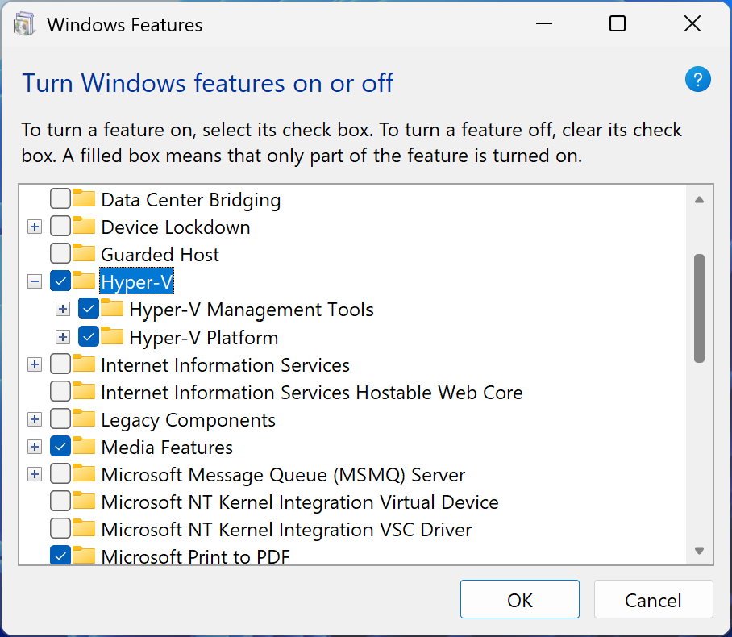
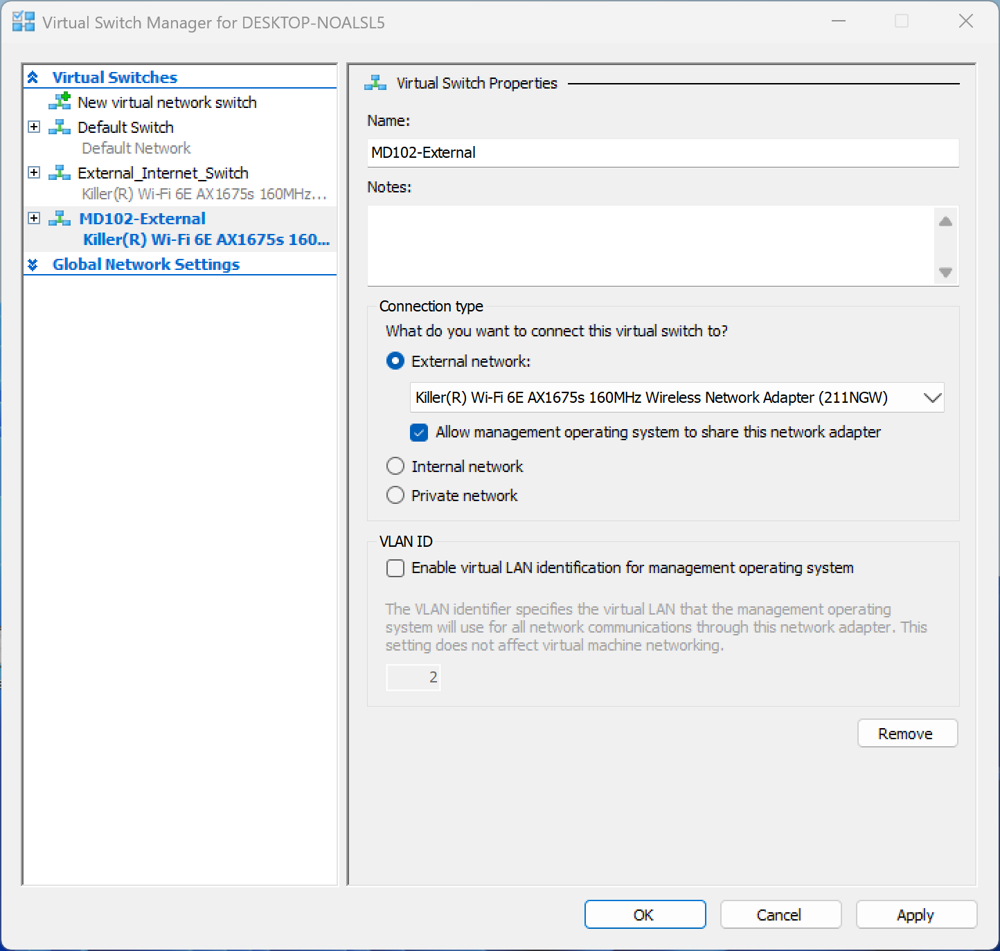
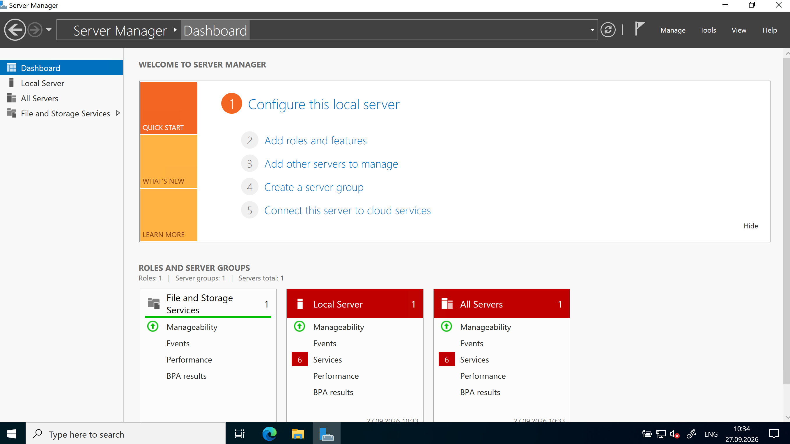
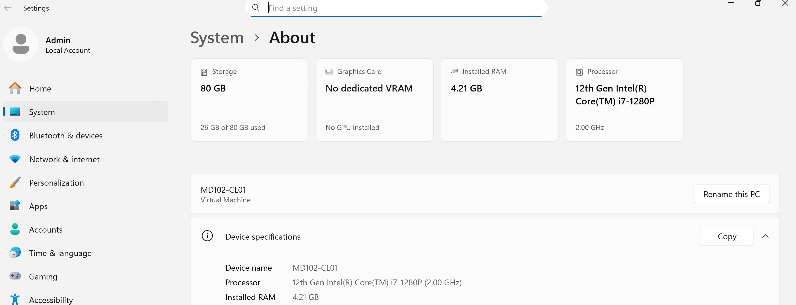
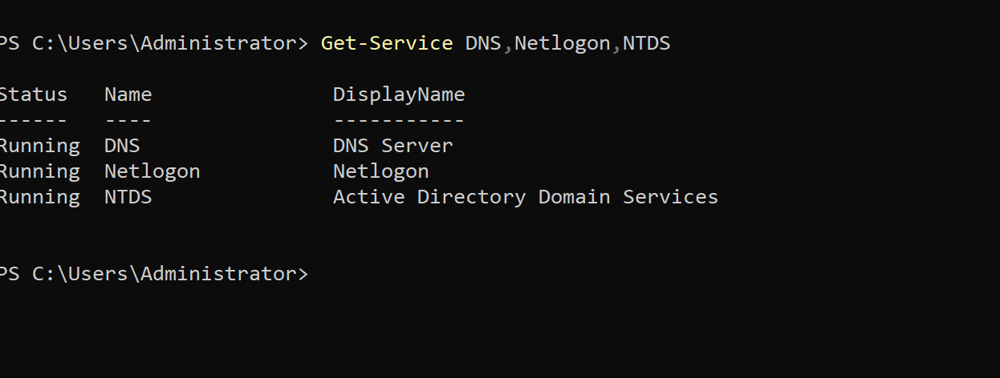
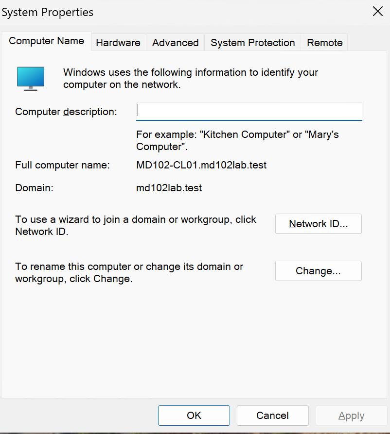

# Lab 01 - Hyper-V, Active Directory and Windows 11 Foundation

## Overview

This lab establishes the core infrastructure used throughout the Microsoft Endpoint Management project.

The environment combines Hyper-V virtualization, Windows Server 2022, Active Directory Domain Services, DNS, and a Windows 11 domain-joined endpoint.

The infrastructure created in this lab provides the foundation for later Microsoft Entra ID, Microsoft Intune, Windows Autopilot, endpoint security, application management, update management, PowerShell, and Microsoft Graph scenarios.

---

## Objective

The objectives of this lab were to:

- Enable Microsoft Hyper-V
- Configure external virtual networking
- Deploy Windows Server 2022
- Configure Active Directory Domain Services and DNS
- Deploy a Windows 11 endpoint
- Join the Windows 11 endpoint to the Active Directory domain
- Validate the environment using PowerShell

---

## Lab Environment

| Component | Configuration |
|---|---|
| Hypervisor | Microsoft Hyper-V |
| Virtual Switch | MD102-External |
| Domain Controller | MD102-DC01 |
| Windows Client | MD102-CL01 |
| Server OS | Windows Server 2022 Datacenter Evaluation |
| Client OS | Windows 11 |
| Active Directory Domain | md102lab.test |
| DNS | Active Directory-integrated DNS |

---

## 1. Hyper-V Configuration

Microsoft Hyper-V was enabled on the host computer to provide the virtualization platform for the lab environment.

Hyper-V is used to isolate and manage the virtual machines required for the endpoint management scenarios in this project.



---

## 2. External Virtual Switch

An external Hyper-V virtual switch named `MD102-External` was created to provide network connectivity to the virtual machines.

The external switch allows the lab systems to communicate with the physical network and access external services when required.



### Troubleshooting

During the initial configuration, Hyper-V was unable to create the external virtual switch because the physical wireless network adapter was associated with an existing Windows Network Bridge.

The conflicting Network Bridge was removed and the Hyper-V external switch was then created successfully.

This demonstrated practical troubleshooting of host networking dependencies in a Hyper-V environment.

---

## 3. Windows Server 2022 Deployment

A Windows Server 2022 virtual machine was deployed in Hyper-V.

The server was configured with the following computer name:

`MD102-DC01`

This server provides the Active Directory Domain Services and DNS infrastructure for the lab.



---

## 4. Windows 11 Endpoint Deployment

A Windows 11 virtual machine was deployed as the primary on-premises endpoint.

The endpoint was configured with the following computer name:

`MD102-CL01`

This device is used to validate domain membership, DNS resolution, Group Policy connectivity, and other traditional Windows management scenarios.



---

## 5. Active Directory Domain Services

Active Directory Domain Services and DNS were configured on `MD102-DC01`.

The Active Directory domain created for the lab is:

`md102lab.test`

Domain Controller functionality and the core Active Directory services were validated using PowerShell.

```powershell
Get-ADDomainController
Get-Service DNS,Netlogon,NTDS
```

The validation confirmed that the domain controller and the required Active Directory services were operational.



---

## 6. Windows 11 Domain Join

`MD102-CL01` was joined to the `md102lab.test` Active Directory domain.

The configuration was validated by confirming domain membership and communication with the domain controller.

Validation included:

- Active Directory domain membership
- DNS resolution
- Domain Controller discovery
- Active Directory connectivity



---

## Architecture

```text
Physical Windows Host
        |
        | Microsoft Hyper-V
        |
   MD102-External
        |
        +--------------------+
        |                    |
        v                    v
   MD102-DC01            MD102-CL01
 Windows Server 2022      Windows 11
        |                    |
        |                    |
 AD DS + DNS <------ Domain Joined
        |
   md102lab.test
```

---

## Skills Demonstrated

This lab demonstrates hands-on experience with:

- Microsoft Hyper-V
- Virtual machine deployment
- Hyper-V virtual networking
- Windows Server 2022
- Active Directory Domain Services
- Active Directory-integrated DNS
- Windows 11 deployment
- Windows domain join
- PowerShell-based infrastructure validation
- Network troubleshooting

---

## Result

The base infrastructure for the Microsoft Endpoint Management lab was successfully deployed and validated.

The completed environment provides:

- Hyper-V virtualization
- External virtual networking
- Windows Server 2022 infrastructure
- Active Directory Domain Services
- Active Directory-integrated DNS
- Domain Controller `MD102-DC01`
- Active Directory domain `md102lab.test`
- Windows 11 endpoint `MD102-CL01`
- Successful Active Directory domain membership

This environment provides the foundation for the remaining Microsoft Endpoint Management labs.
