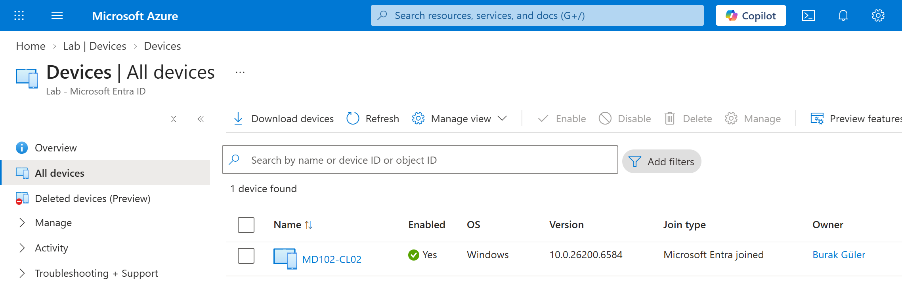
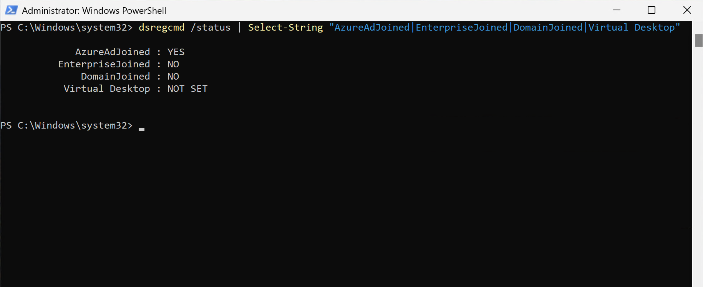
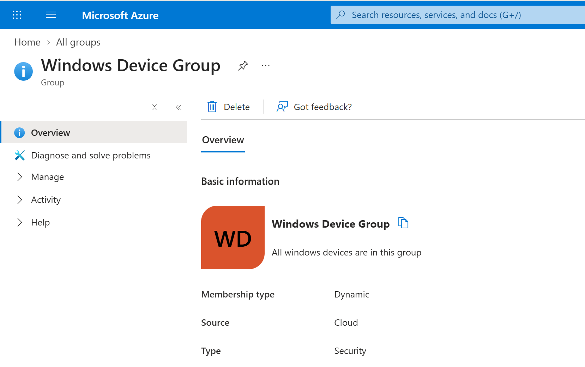

# Lab 02 - Microsoft Entra ID Device Management

## Objective

Join a Windows 11 endpoint directly to Microsoft Entra ID and validate the device identity from both the endpoint and the Entra admin center.

## Environment

| Component | Configuration |
|---|---|
| Identity Platform | Microsoft Entra ID |
| Endpoint | MD102-CL02 |
| Operating System | Windows 11 |
| Join Type | Microsoft Entra Joined |
| On-Premises Domain | Not joined |
| Device Group | Windows Device Group |

---

## 1. Microsoft Entra Join

`MD102-CL02` was joined directly to Microsoft Entra ID.

The device was then verified in the Microsoft Entra admin center.



---

## 2. Join State Verification

The device join state was verified locally using:

```powershell
dsregcmd /status
```

The relevant values confirmed:

- `AzureAdJoined : YES`
- `DomainJoined : NO`

This verified that the endpoint was cloud joined and not joined to the on-premises Active Directory domain.



---

## 3. Device Security Group

A Microsoft Entra security group was created for device targeting.

The group is used later in the lab for assigning Intune policies, applications, compliance settings, and other device-based configurations.



---

## Notes

Microsoft Entra supports multiple Windows device identity models:

- Microsoft Entra joined
- Microsoft Entra registered
- Microsoft Entra hybrid joined

This lab uses a Microsoft Entra joined device because `MD102-CL02` is intended to represent a cloud-managed corporate endpoint.

---

## Result

`MD102-CL02` was successfully joined to Microsoft Entra ID.

The join state was verified locally with `dsregcmd`, and the device was confirmed in the Entra admin center.

A security group was also created for later device-based targeting.
