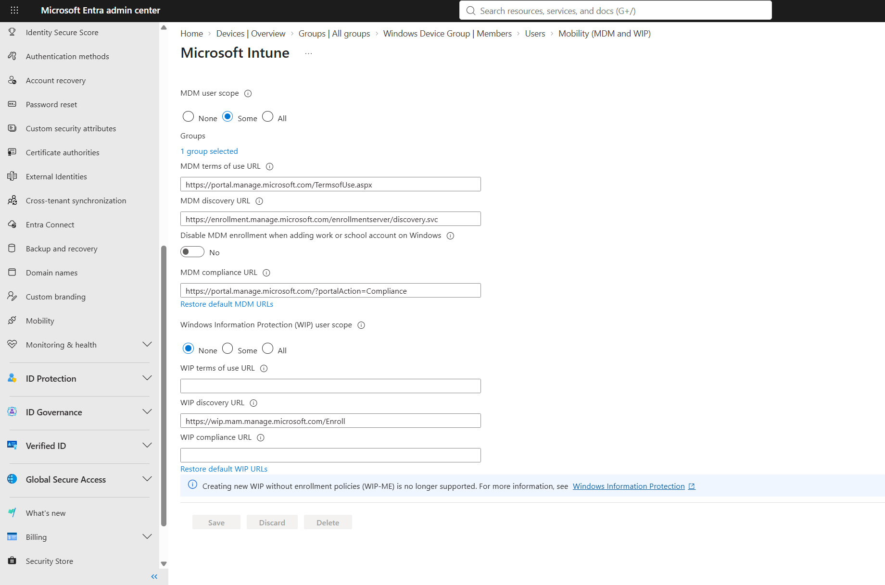
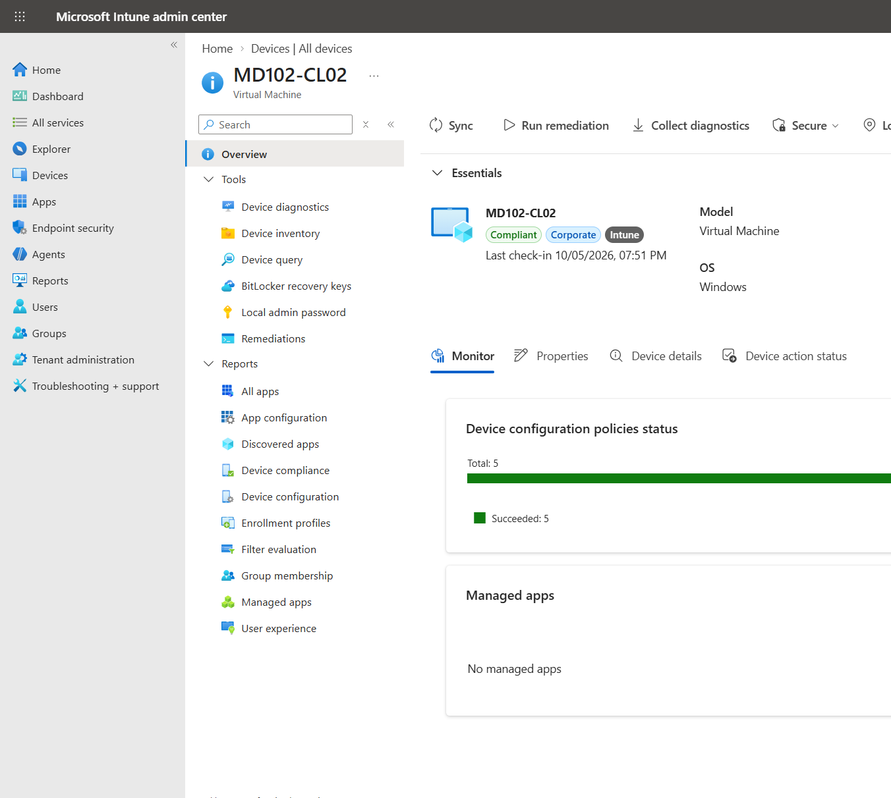

# Lab 03 - Microsoft Intune Enrollment

## Objective

Configure automatic Microsoft Intune enrollment for a Microsoft Entra joined Windows 11 endpoint and verify that the device is successfully managed by Intune.

## Environment

| Component | Configuration |
|---|---|
| Endpoint | MD102-CL02 |
| Operating System | Windows 11 |
| Identity Platform | Microsoft Entra ID |
| Join Type | Microsoft Entra joined |
| Device Management | Microsoft Intune |
| Enrollment Method | Automatic MDM enrollment |
| Enrollment Group | MD102-Intune-Users |

---

## 1. Configure Automatic MDM Enrollment

Automatic MDM enrollment was configured for selected users.

The Microsoft Intune MDM user scope was set to target the `MD102-Intune-Users` security group.

This allows users in the group to automatically enroll supported Microsoft Entra joined devices into Intune.



---

## 2. Enroll the Windows 11 Endpoint

`MD102-CL02` was joined to Microsoft Entra ID using a user included in the Intune MDM enrollment scope.

After enrollment completed, the device appeared in the Intune admin center as:

- Corporate owned
- Managed by Microsoft Intune
- Compliant



---

## 3. Enrollment Verification

The local device registration state was checked with:

```powershell
dsregcmd /status
```

The relevant results included:

- `AzureAdJoined : YES`
- `DomainJoined : NO`
- Microsoft Intune MDM service URLs

The Intune admin center was then used to confirm that the endpoint was actively managed.

---

## Troubleshooting

`MD102-CL02` initially appeared in Microsoft Entra ID but did not appear as an Intune-managed device.

The MDM user scope had been configured after the original Microsoft Entra join.

The issue was resolved by:

1. Configuring the Microsoft Intune MDM user scope.
2. Adding the test user to `MD102-Intune-Users`.
3. Rejoining `MD102-CL02` to Microsoft Entra ID.
4. Confirming the device enrollment in Intune.

---

## Result

`MD102-CL02` was successfully enrolled into Microsoft Intune through automatic MDM enrollment.

The endpoint is now available for device configuration, compliance policies, security policies, application deployment, and update management.
