# Lab 04 - Identity and Compliance

## Objective

Configure identity administration, scoped access, device compliance, Conditional Access, Windows Hello for Business, and Windows LAPS using Microsoft Entra ID and Microsoft Intune.

## Environment

| Component | Configuration |
|---|---|
| Identity Platform | Microsoft Entra ID |
| Endpoint Management | Microsoft Intune |
| Managed Endpoint | MD102-CL02 |
| Device Group | Windows Device Group |
| Intune Admin Group | MD102-Intune-HelpDesk-Admins |
| Scope Tag | MD102-Windows-Scope |

---

## 1. Microsoft Entra Role Assignment

A built-in Microsoft Entra administrative role was assigned to a test user.

The assignment was verified from the Microsoft Entra admin center.

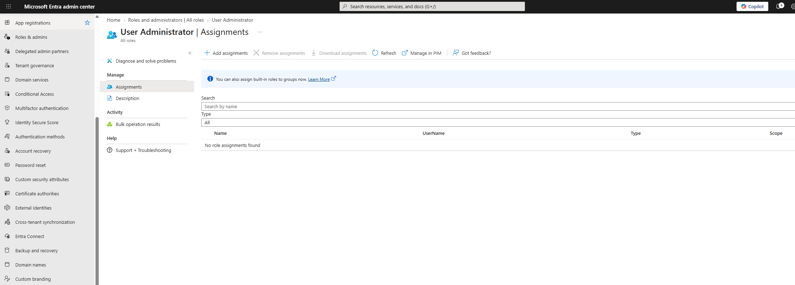

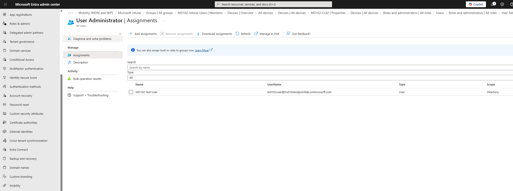

---

## 2. Microsoft Intune RBAC

The Intune `Help Desk Operator` role was assigned through the `MD102-Intune-HelpDesk-Admins` security group.

The assignment was scoped to the Windows device group to limit administrative access to the required devices.

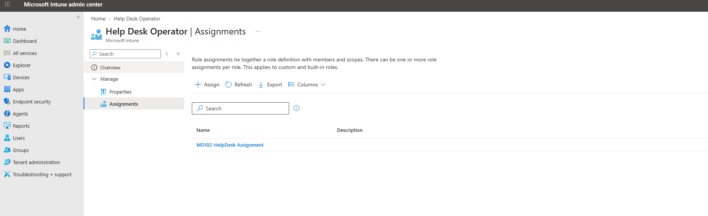

---

## 3. Scope Tag

A custom Intune scope tag named `MD102-Windows-Scope` was created.

The scope tag was used to support scoped administration within the lab environment.

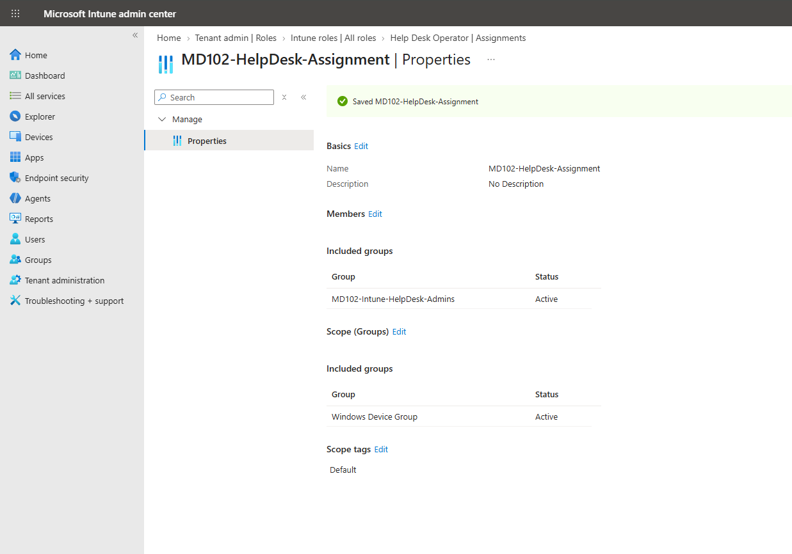

---

## 4. Windows Compliance Policy

A Windows compliance policy named `MD102-Windows-Compliance` was created.

The policy included device security requirements such as:

- BitLocker
- Secure Boot

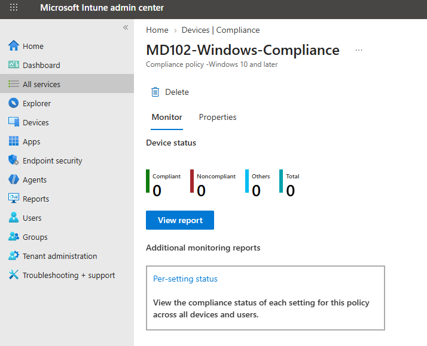

The policy was assigned to `Windows Device Group`.

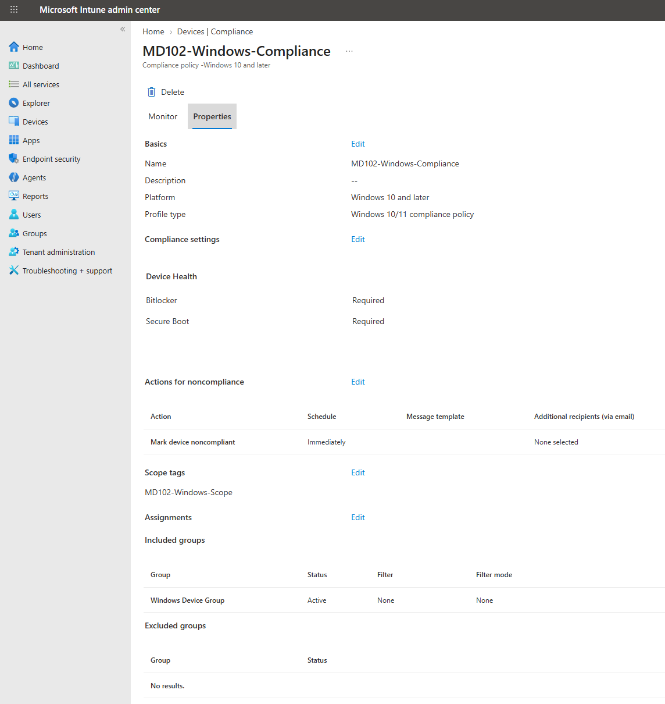

Compliance evaluation was then verified for `MD102-CL02`.

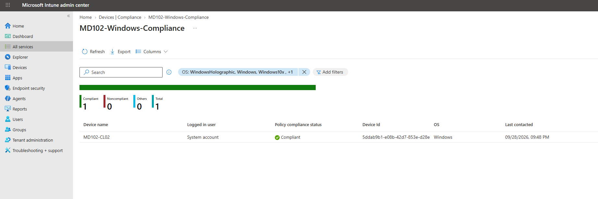

---

## 5. Conditional Access

A Conditional Access policy named `MD102-Require-Compliant-Windows` was created.

The policy targets Windows sign-ins and requires the device to be marked as compliant.

The policy was configured in report-only mode during testing.

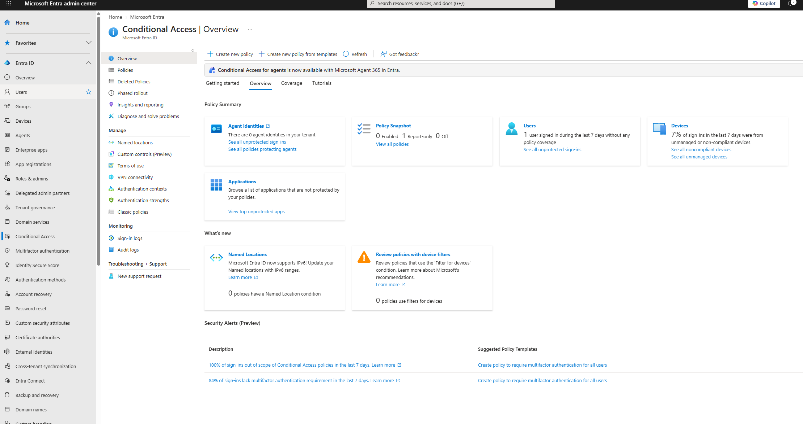

The grant control was configured to require a compliant device.

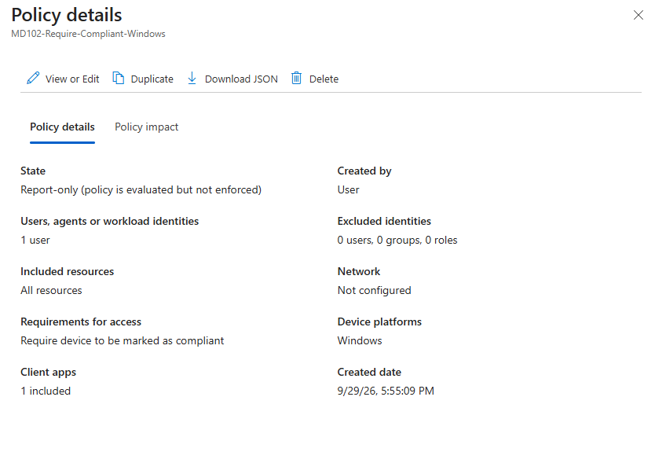

---

## 6. Windows Hello for Business

A Windows Hello for Business policy was created in Intune and assigned to `Windows Device Group`.

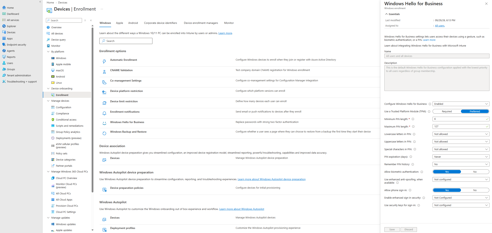

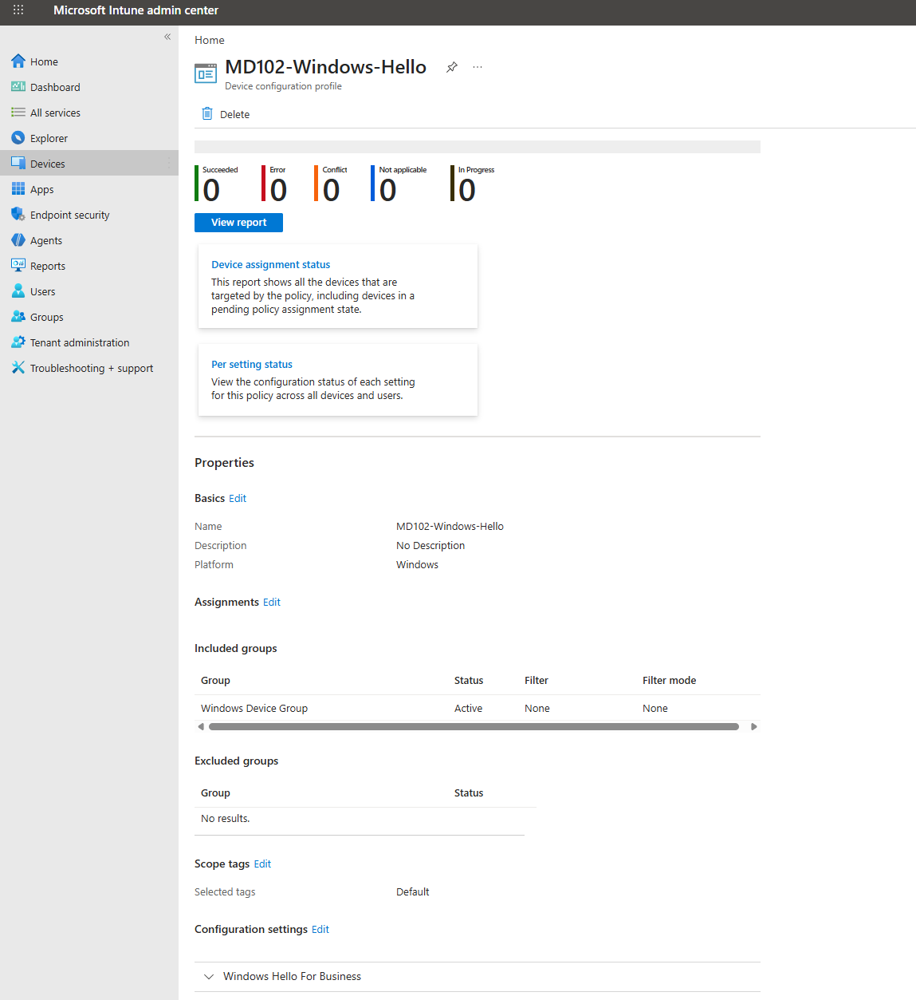

Windows Hello sign-in options were then verified on `MD102-CL02`.

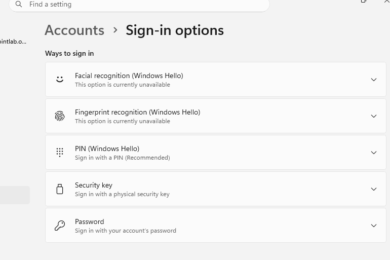

---

## 7. Windows LAPS

Windows LAPS was configured through Microsoft Intune.

The policy was configured to manage the local administrator password and back it up to Microsoft Entra ID.

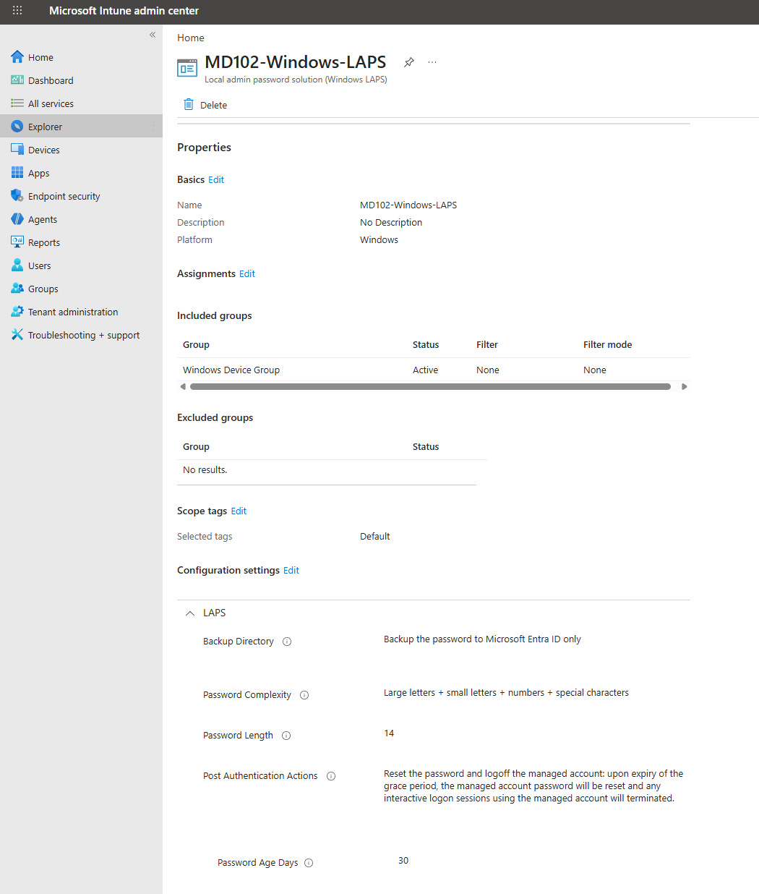

The policy was assigned to the Windows device group.

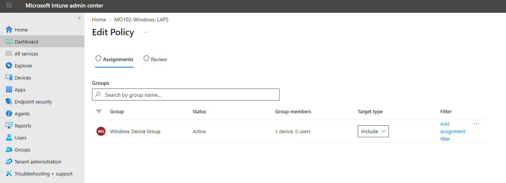

Microsoft Entra ID LAPS integration was enabled for the tenant.

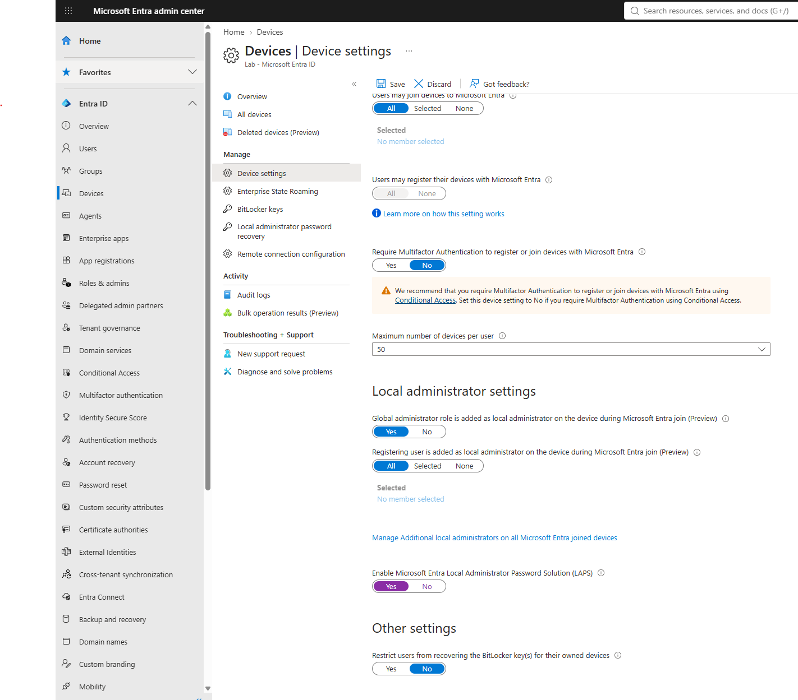

Password rotation and Microsoft Entra ID backup were verified after the policy was applied.

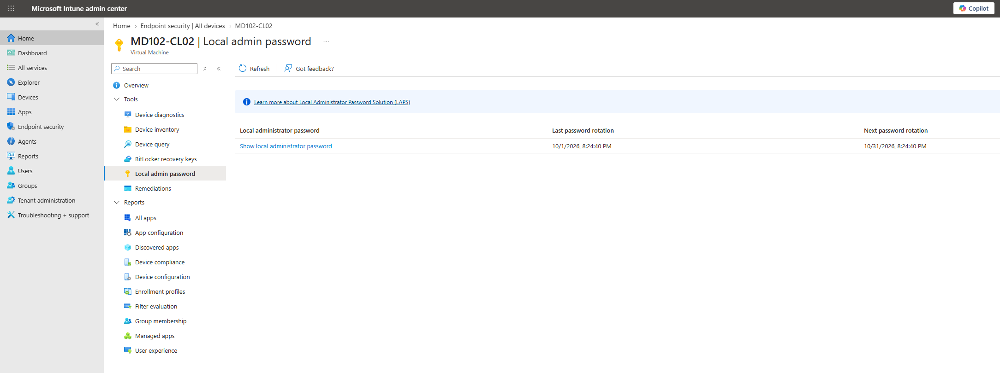

---

## Result

The following configurations were completed and validated:

- Microsoft Entra administrative role assignment
- Microsoft Intune RBAC
- Scoped administration with an Intune scope tag
- Windows device compliance policy
- Device compliance monitoring
- Conditional Access requiring a compliant device
- Windows Hello for Business
- Windows LAPS with Microsoft Entra ID password backup

`MD102-CL02` was used to validate the endpoint-facing configurations.
