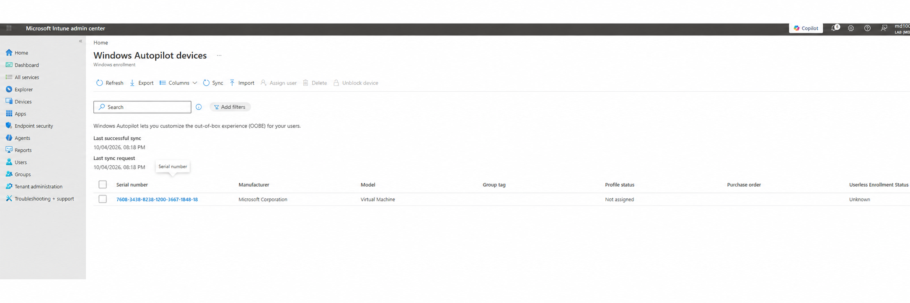
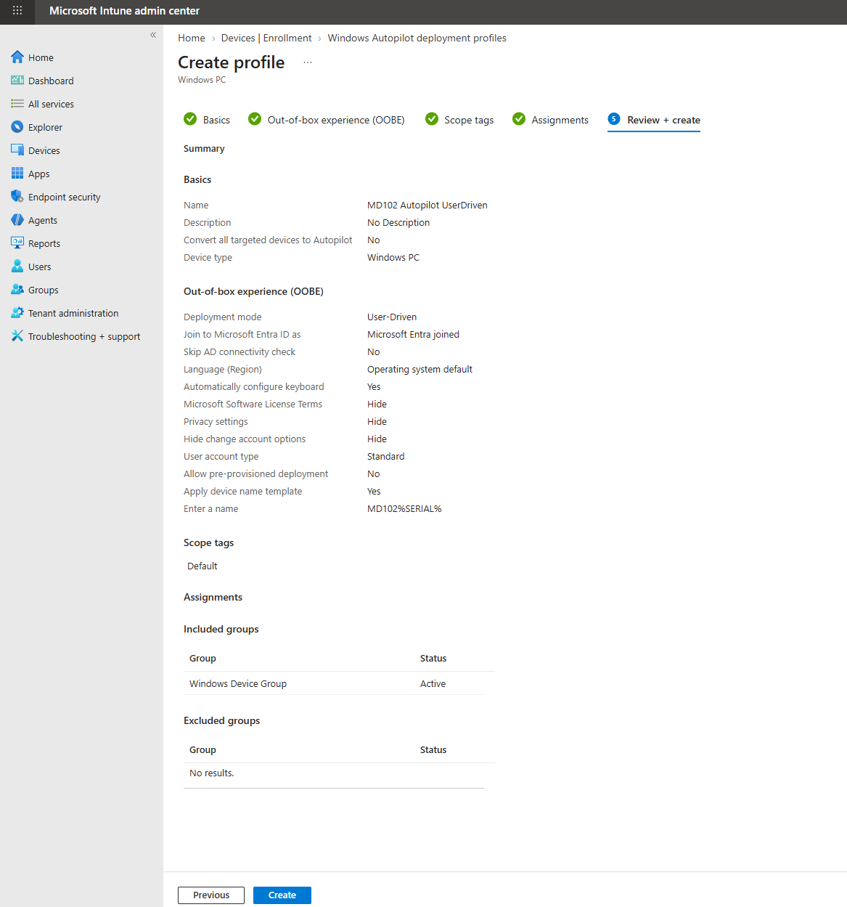
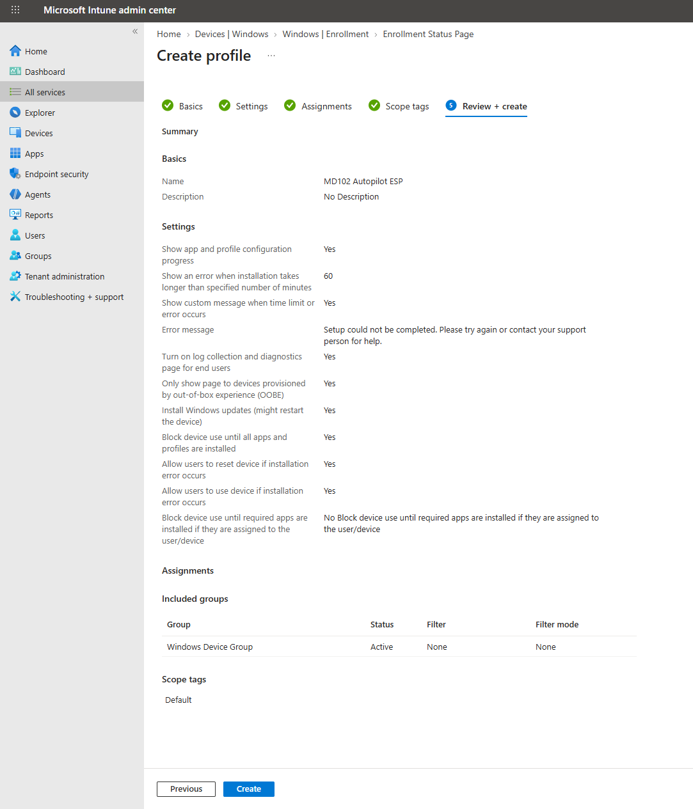
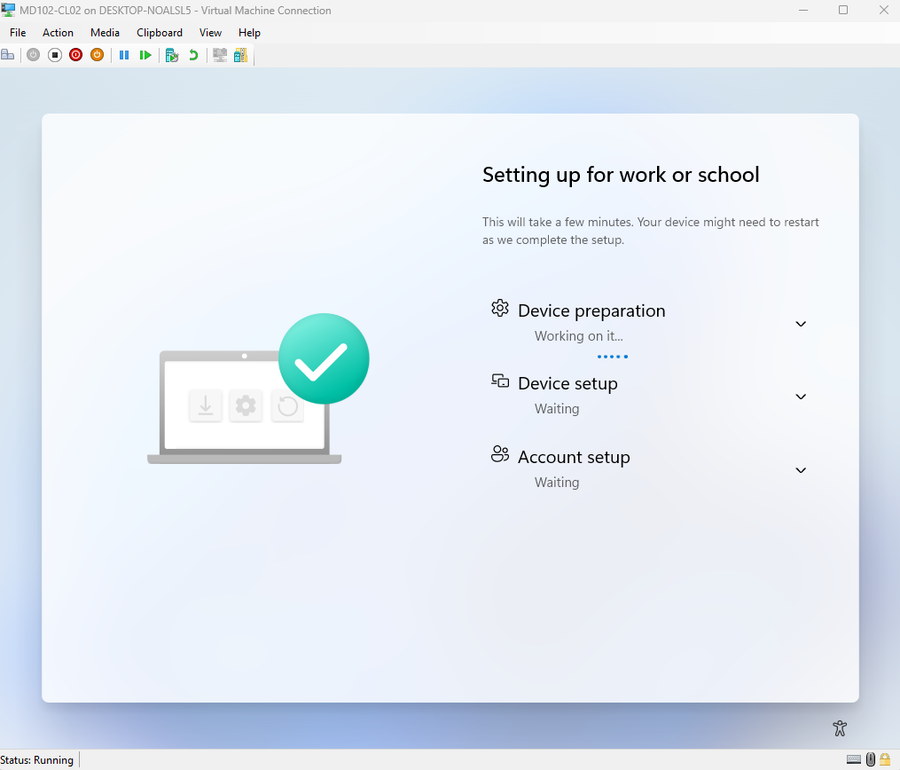

# Lab 05 - Windows Autopilot

## Objective

Register a Windows 11 device with Windows Autopilot, assign a user-driven deployment profile, configure an Enrollment Status Page, and validate the deployment through Windows OOBE.

## Environment

| Component | Configuration |
|---|---|
| Endpoint | MD102-CL02 |
| Operating System | Windows 11 |
| Management Platform | Microsoft Intune |
| Identity Platform | Microsoft Entra ID |
| Deployment Mode | User-Driven |
| Join Type | Microsoft Entra Joined |
| User Account Type | Standard |
| Deployment Method | Windows Autopilot |

---

## 1. Autopilot Device Registration

The hardware hash for `MD102-CL02` was collected and imported into Microsoft Intune.

After synchronization completed, the device appeared in the Windows Autopilot device list.

The hardware hash CSV was used only for registration and was not stored in the repository.

---

## 2. Autopilot Deployment Profile

A user-driven Windows Autopilot deployment profile was created.

The profile was configured with:

- User-driven deployment
- Microsoft Entra join
- Standard user account
- Hidden Microsoft Software License Terms
- Hidden privacy settings
- Automatic keyboard configuration
- Device naming using `MD102%SERIAL%`

---

## 3. Enrollment Status Page

An Enrollment Status Page was configured for the Autopilot deployment.

The ESP tracks the main provisioning stages:

- Device preparation
- Device setup
- Account setup
- Policy processing
- Application installation

---

## 4. Autopilot Deployment Validation

`MD102-CL02` was reset and returned to the Windows out-of-box experience.

Because the device was registered with Windows Autopilot and targeted by the deployment profile, it entered the organization-managed provisioning flow.

The Enrollment Status Page processed the device preparation, device setup, and account setup stages during deployment.

---

## Troubleshooting

PowerShell execution policy initially prevented the Autopilot hardware hash script from running.

The restriction was bypassed only for the active PowerShell process so the hardware hash could be collected without changing the permanent execution policy.

The imported Autopilot device also required time to synchronize before it became available in the Intune portal.

---

## Result

`MD102-CL02` was successfully registered and provisioned through Windows Autopilot.

The completed configuration included:

- Autopilot hardware hash registration
- User-driven deployment profile
- Microsoft Entra join
- Standard user provisioning
- Enrollment Status Page
- Windows OOBE deployment validation

The hardware hash and registration CSV were not stored in the GitHub repository.
