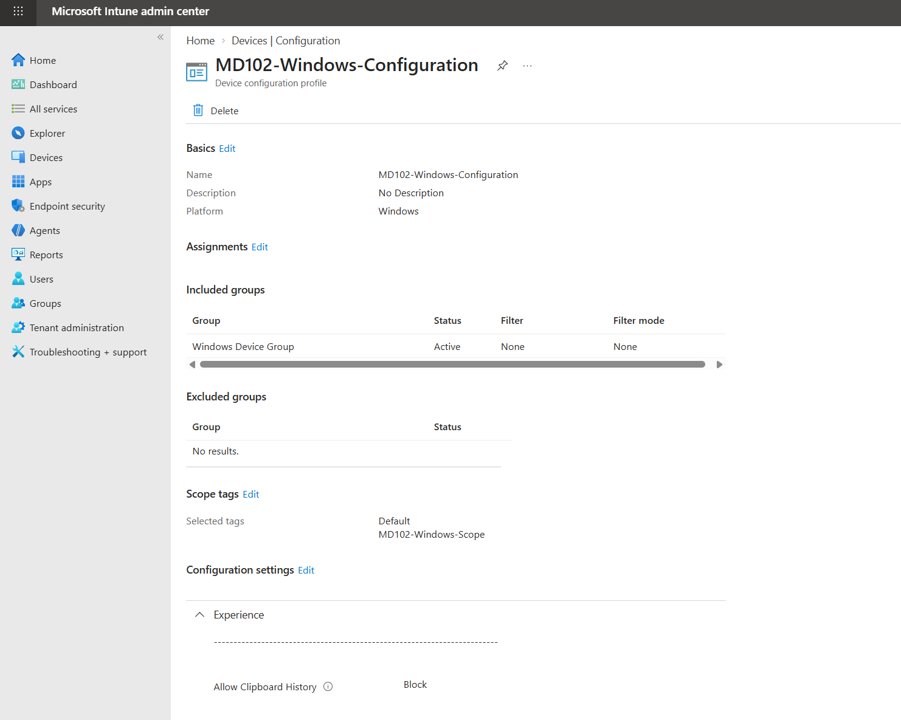
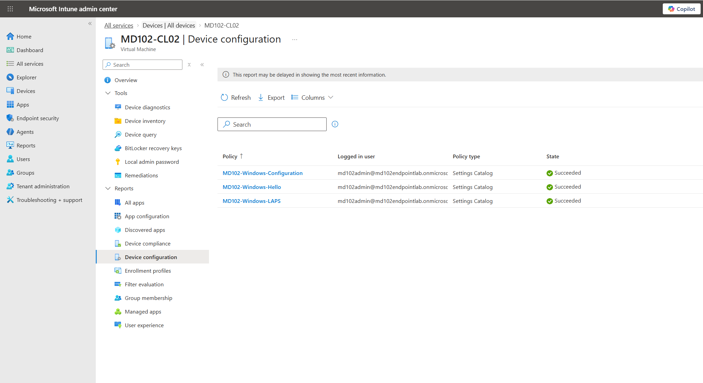
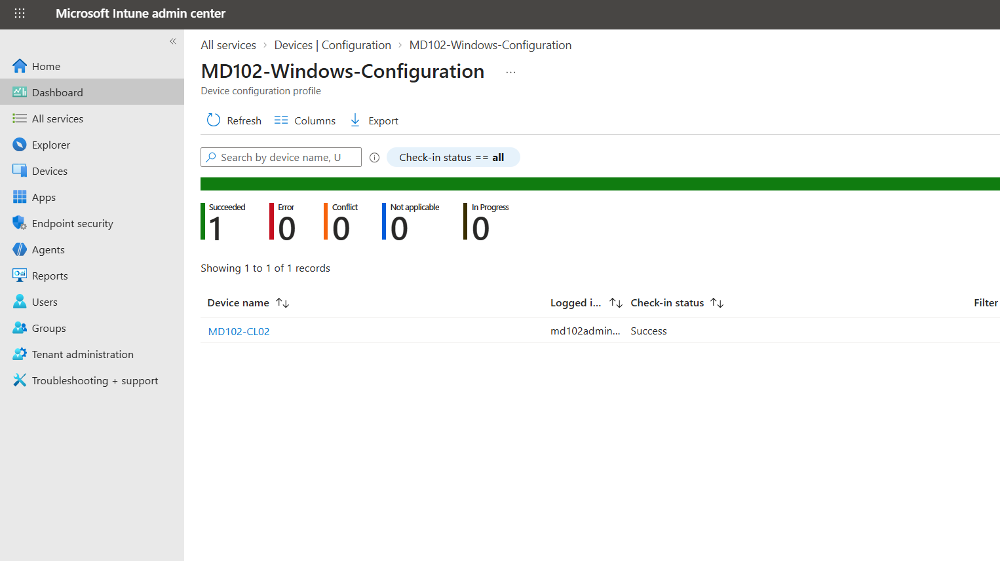
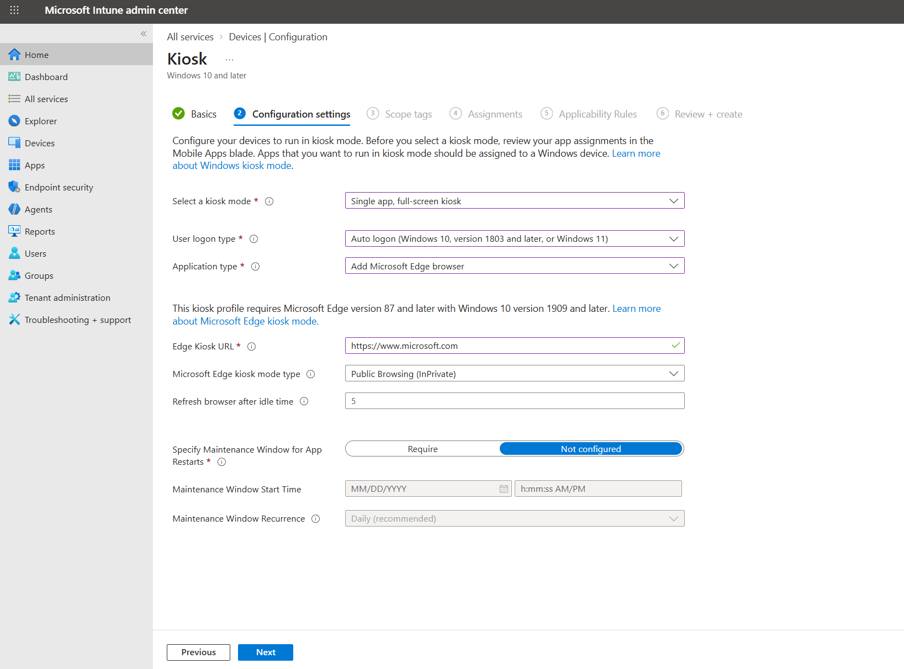
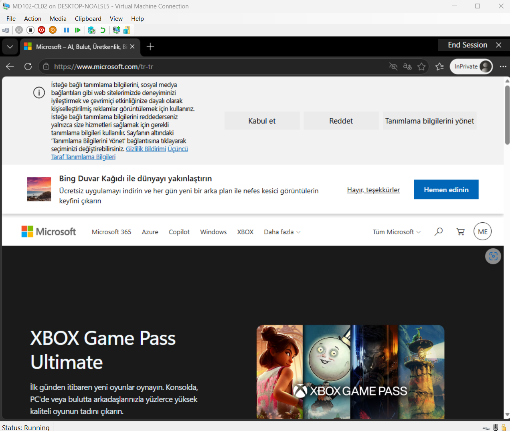

# Lab 06 - Device Configuration

## Objective

Create and validate Windows configuration profiles in Microsoft Intune, monitor policy deployment, and test a single-app kiosk configuration on a managed Windows 11 endpoint.

## Environment

| Component | Configuration |
|---|---|
| Endpoint | MD102-CL02 |
| Operating System | Windows 11 |
| Management Platform | Microsoft Intune |
| Target Group | Windows Device Group |

---

## 1. Windows Configuration Profile

A Settings Catalog profile named `MD102-Windows-Configuration` was created.

The policy was configured to disable Windows Clipboard History and assigned to `Windows Device Group`.

---

## 2. Policy Deployment Validation

The policy was synchronized with `MD102-CL02`.

Deployment status was then checked from the Intune admin center to confirm that the configuration had been processed successfully.

---

## 3. Configuration Monitoring

The configuration profile was reviewed using Intune monitoring data.

The monitoring views were used to check:

- Successful deployments
- Errors
- Conflicts
- Pending states
- Per-setting status

---

## 4. Windows Kiosk Configuration

A single-app full-screen kiosk profile was created in Microsoft Intune.

The profile was configured to:

- Automatically sign in with the kiosk account
- Launch Microsoft Edge
- Open a predefined website
- Use Public Browsing mode
- Restrict the endpoint to the kiosk experience

---

## 5. Kiosk Validation

The kiosk profile was temporarily assigned to `Windows Device Group` and tested on `MD102-CL02`.

The endpoint signed in to the kiosk account and automatically opened Microsoft Edge in kiosk mode.

After validation, the kiosk assignment was removed so the endpoint could continue to be used for the remaining labs.

---

## Notes

Android and iOS configuration profile concepts were reviewed during the training, but no Android or iOS endpoint was deployed in this lab environment.

---

## Result

The following configurations were completed and validated:

- Windows Settings Catalog profile
- Device group assignment
- Configuration profile monitoring
- Policy deployment validation on `MD102-CL02`
- Single-app Microsoft Edge kiosk profile
- Kiosk mode validation on a managed Windows endpoint
