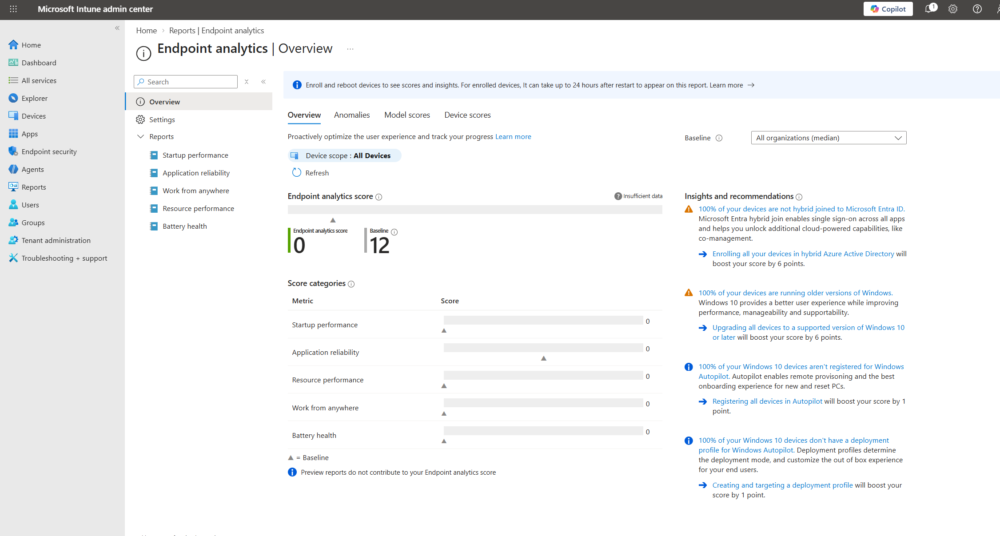
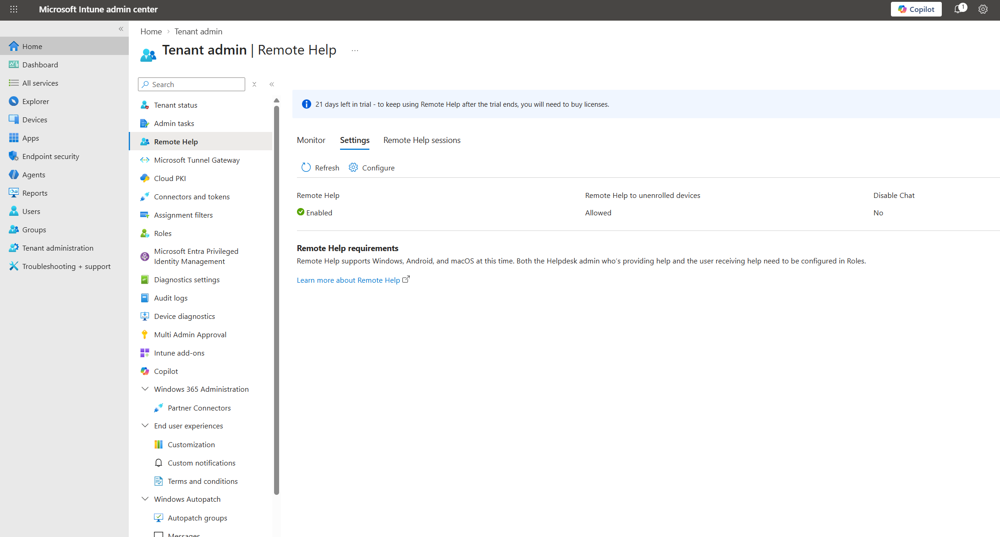
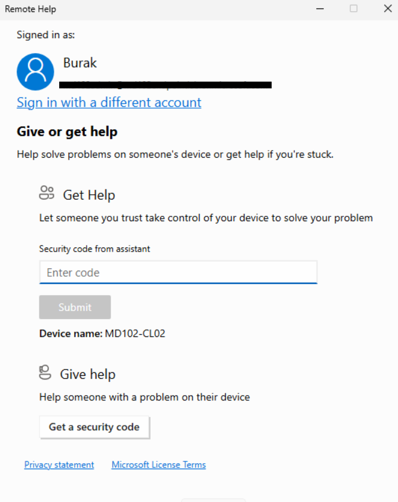

# Lab 07 - Intune Suite Add-on Capabilities

## Objective

Configure and review selected Microsoft Intune Suite capabilities, focusing on Endpoint Analytics and Microsoft Remote Help.

## Environment

| Component | Configuration |
|---|---|
| Endpoint | MD102-CL02 |
| Management Platform | Microsoft Intune |
| Identity Platform | Microsoft Entra ID |
| Remote Support | Microsoft Remote Help |

---

## 1. Endpoint Analytics

Endpoint Analytics was enabled for the managed environment.

The feature was reviewed for visibility into areas such as:

- Startup performance
- Application reliability
- Resource performance
- Work from anywhere
- Battery health

At the time of validation, the environment did not yet contain enough collected telemetry to populate all analytics views.

---

## 2. Microsoft Remote Help

Microsoft Remote Help was enabled at the tenant level.

The tenant settings were reviewed and configured for remote assistance scenarios.

The Remote Help application was installed on `MD102-CL02` and opened successfully.

The client was ready for a remote assistance session.

A complete live remote support session was not performed as part of this lab.

---

## 3. Microsoft Tunnel

Microsoft Tunnel architecture and use cases were reviewed.

Microsoft Tunnel is designed to provide secure VPN access from supported managed mobile devices to internal resources.

A Tunnel gateway was not deployed because the lab environment does not include the required Linux gateway and mobile device infrastructure.

---

## Result

The following tasks were completed:

- Enabled Endpoint Analytics
- Reviewed endpoint performance and experience reporting
- Enabled Microsoft Remote Help
- Configured Remote Help tenant settings
- Installed and opened the Remote Help client on `MD102-CL02`
- Reviewed Microsoft Tunnel architecture

Endpoint Analytics required additional telemetry collection time, and Microsoft Tunnel was reviewed without deploying a gateway.
