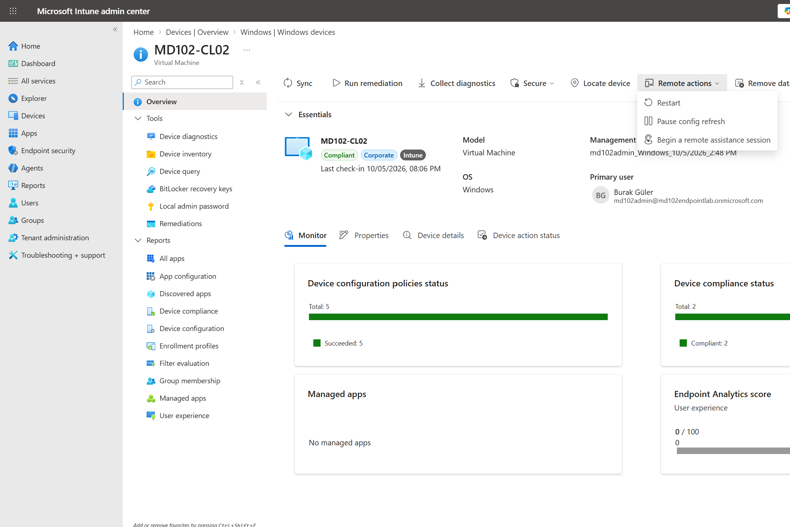
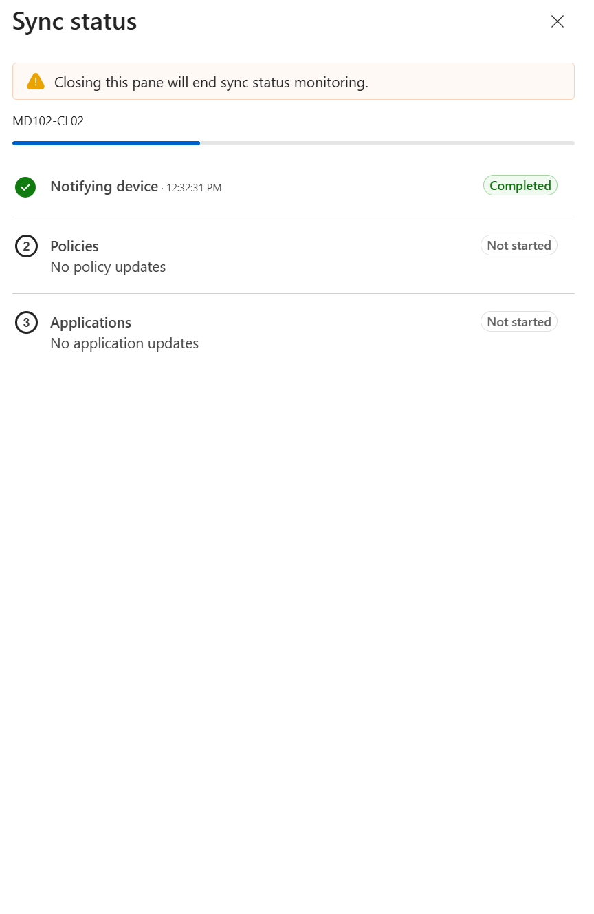
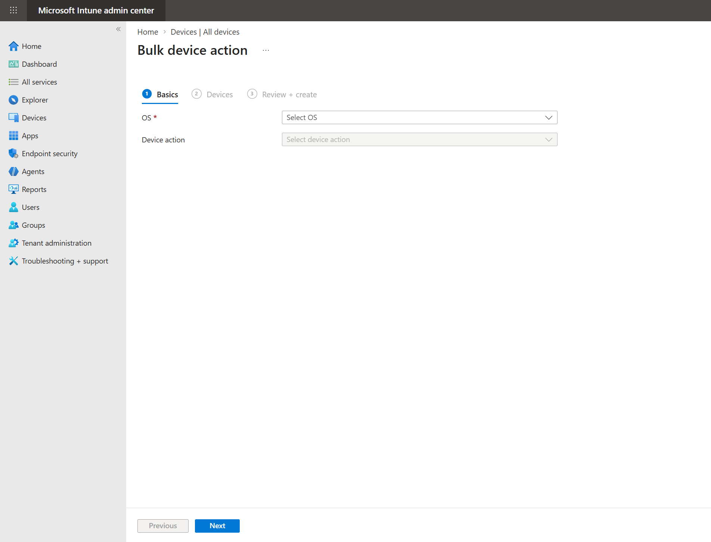
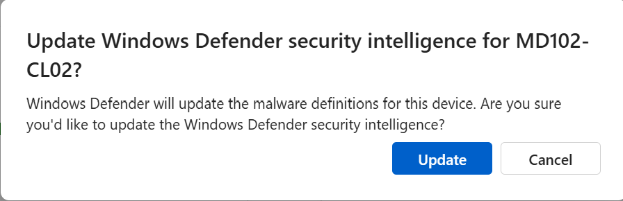
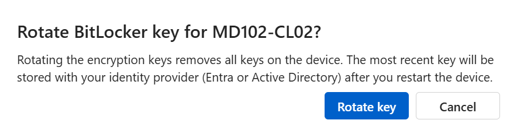
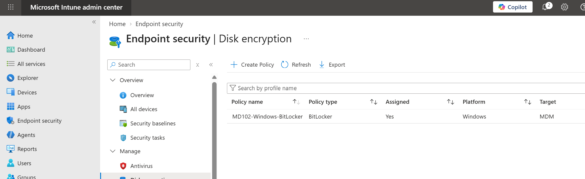
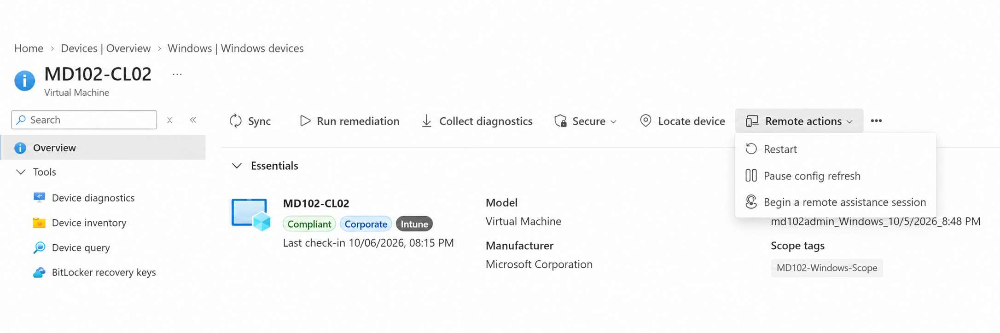

# Lab 08 - Remote Device Management

## Objective

Perform and review common remote device management actions in Microsoft Intune using the Windows 11 endpoint `MD102-CL02`.

## Environment

| Component | Configuration |
|---|---|
| Endpoint | MD102-CL02 |
| Operating System | Windows 11 |
| Management Platform | Microsoft Intune |
| Identity Platform | Microsoft Entra ID |
| Device State | Corporate / Intune managed |

---

## 1. Remote Device Actions

The remote actions available for `MD102-CL02` were reviewed from the Intune admin center.

Available actions included:

- Sync
- Restart
- Retire
- Wipe
- Defender security intelligence update
- BitLocker recovery key rotation

Retire and Wipe were reviewed but not executed to avoid removing or resetting the lab endpoint.

---

## 2. Device Sync

A remote Sync action was triggered for `MD102-CL02`.

This forces the endpoint to contact Microsoft Intune and retrieve current policies and management instructions.

---

## 3. Bulk Device Actions

The Bulk Device Actions interface was reviewed.

This feature allows supported management actions to be applied to multiple managed endpoints from a single workflow.

---

## 4. Microsoft Defender Security Intelligence Update

A Microsoft Defender security intelligence update was triggered remotely for `MD102-CL02`.

The action requests the endpoint to update its current Microsoft Defender security intelligence definitions.

---

## 5. BitLocker Recovery Key Management

The BitLocker recovery key rotation action was reviewed and triggered.

During validation, the operating system volume did not have active BitLocker protection and no recovery key was available in Intune.

A disk encryption policy named `MD102-Windows-BitLocker` was therefore created and assigned to the Windows device group.

Successful recovery key rotation was not fully validated in this lab.

---

## 6. Device Query with KQL

Microsoft Intune Device Query was reviewed against `MD102-CL02`.

Available inventory entities included examples such as:

- `OsVersion`
- `Cpu`
- `DiskDrive`
- `EncryptableVolume`

A real-time KQL query was attempted, but the query returned a service or prerequisite error.

The feature was therefore reviewed but not recorded as successfully validated.

---

## 7. Remote Restart

A remote Restart action was triggered from Microsoft Intune for `MD102-CL02`.

The endpoint received the action and restarted successfully.

---

## Result

The following remote management tasks were completed or reviewed:

- Triggered a device Sync
- Reviewed bulk device actions
- Triggered a Microsoft Defender security intelligence update
- Reviewed BitLocker recovery key rotation
- Created and assigned a BitLocker disk encryption policy
- Reviewed Device Query and KQL capabilities
- Triggered and validated a remote Windows restart
- Reviewed Retire and Wipe without executing destructive actions
