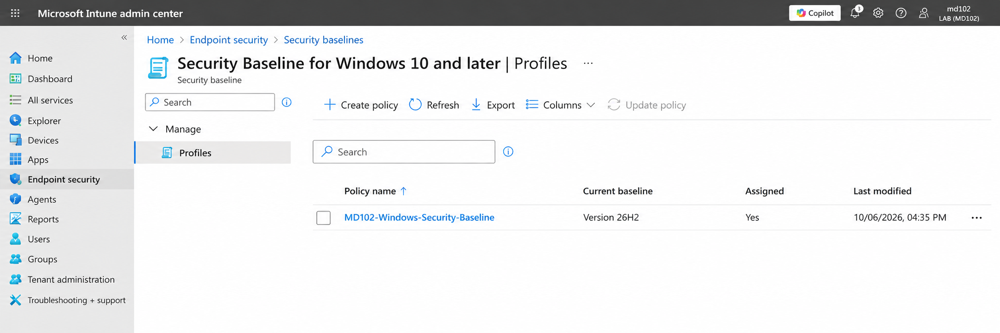
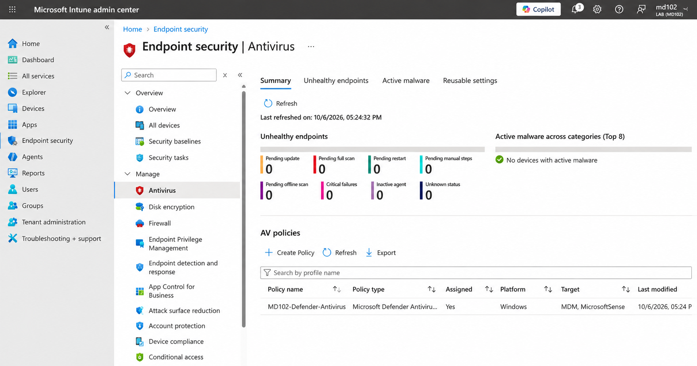
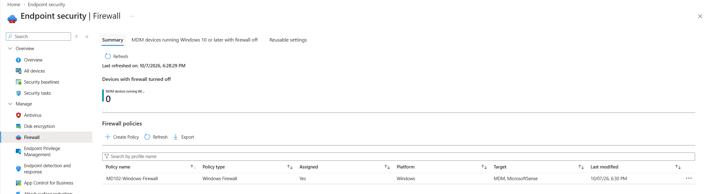
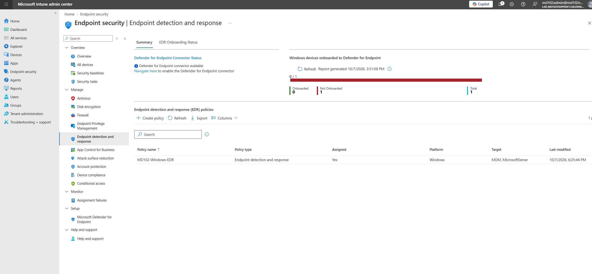
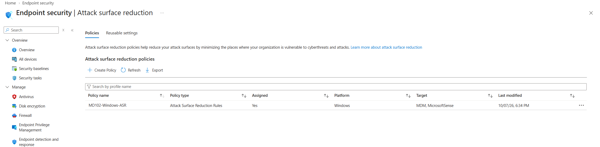
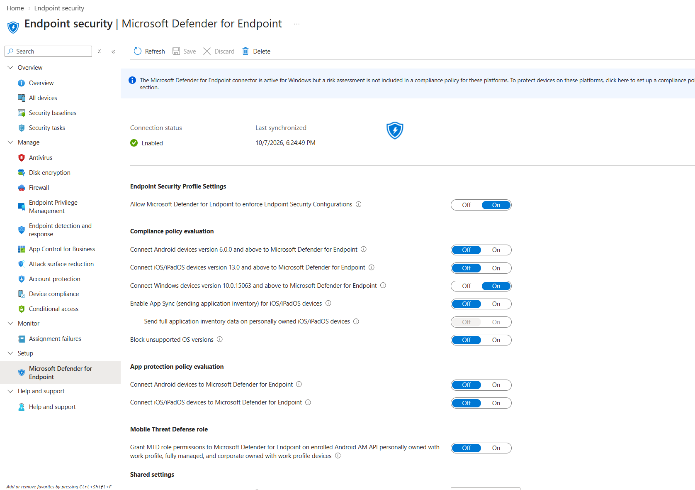
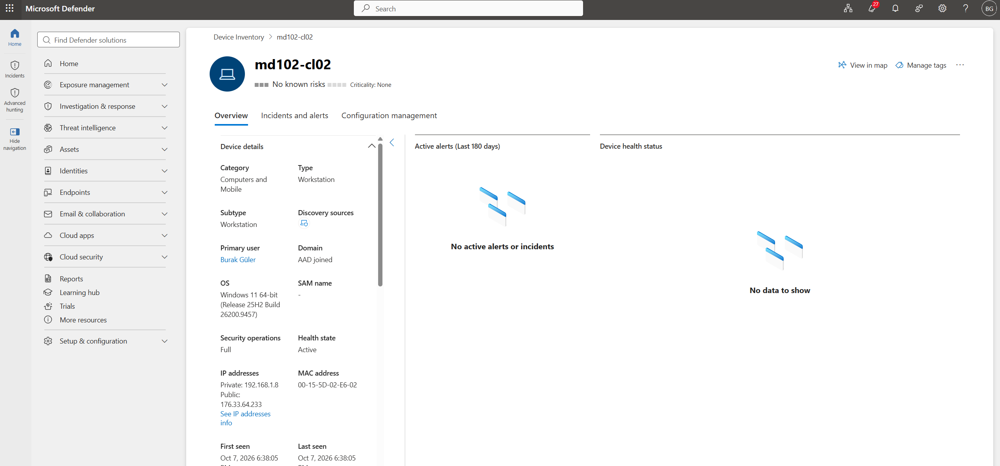

# Lab 09 - Endpoint Security

## Objective

Configure endpoint security policies in Microsoft Intune, connect the environment to Microsoft Defender for Endpoint, and validate onboarding of the managed Windows 11 endpoint.

## Environment

| Component | Configuration |
|---|---|
| Endpoint | MD102-CL02 |
| Operating System | Windows 11 |
| Management Platform | Microsoft Intune |
| Security Platform | Microsoft Defender for Endpoint |
| Target Group | Windows Device Group |

---

## 1. Windows Security Baseline

A Windows security baseline named `MD102-Windows-Security-Baseline` was created and assigned to `Windows Device Group`.

---

## 2. Microsoft Defender Antivirus

A Microsoft Defender Antivirus policy was created in Intune.

The policy included controls such as:

- Real-time monitoring
- Behavior monitoring
- Cloud protection
- Downloaded file and attachment scanning
- Script scanning
- Network protection
- Potentially unwanted application protection
- On-access protection

The policy was assigned to `Windows Device Group`.

---

## 3. Microsoft Defender Firewall

A Microsoft Defender Firewall policy was created for the managed Windows devices.

Firewall protection was enabled for:

- Domain networks
- Private networks
- Public networks

Inbound traffic was configured with a restrictive posture while outbound traffic remained allowed by default.

---

## 4. Endpoint Detection and Response

An Endpoint Detection and Response policy named `MD102-Windows-EDR` was created.

The policy was used to onboard managed Windows devices to Microsoft Defender for Endpoint and was assigned to `Windows Device Group`.

---

## 5. Attack Surface Reduction

An Attack Surface Reduction policy named `MD102-Windows-ASR` was created.

Selected ASR rules were configured in Audit mode so behavior could be evaluated without immediately blocking applications.

The configured controls included:

- Credential stealing from LSASS
- Office child process creation
- Office executable content creation
- Executable content from email and webmail
- JavaScript and VBScript launching downloaded executables
- Vulnerable signed driver abuse
- WMI event subscription persistence

---

## 6. Microsoft Defender for Endpoint Integration

Microsoft Intune was connected to Microsoft Defender for Endpoint.

Windows device integration was enabled so Intune-managed endpoints could participate in Defender for Endpoint security workflows.

---

## 7. Defender for Endpoint Onboarding Validation

`MD102-CL02` was onboarded to Microsoft Defender for Endpoint.

The device appeared in Microsoft Defender Device Inventory with an active health state.

---

## Result

The following endpoint security configurations were completed:

- Windows Security Baseline
- Microsoft Defender Antivirus policy
- Microsoft Defender Firewall policy
- Endpoint Detection and Response policy
- Attack Surface Reduction policy
- Microsoft Defender for Endpoint integration
- Onboarding of `MD102-CL02`
- Device health validation in Microsoft Defender
