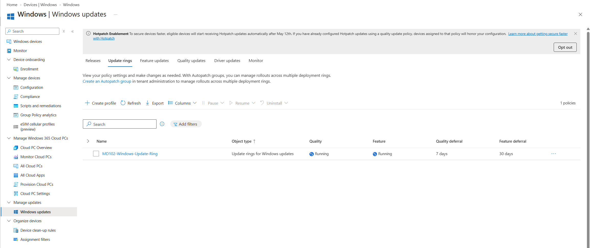
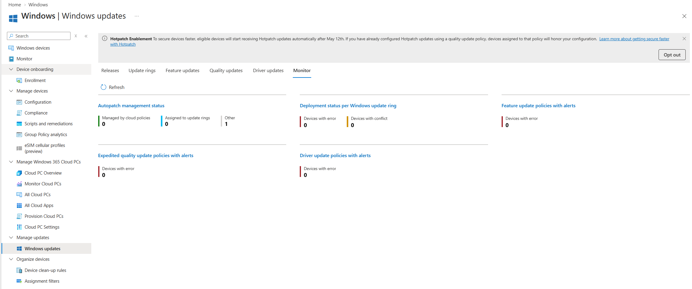
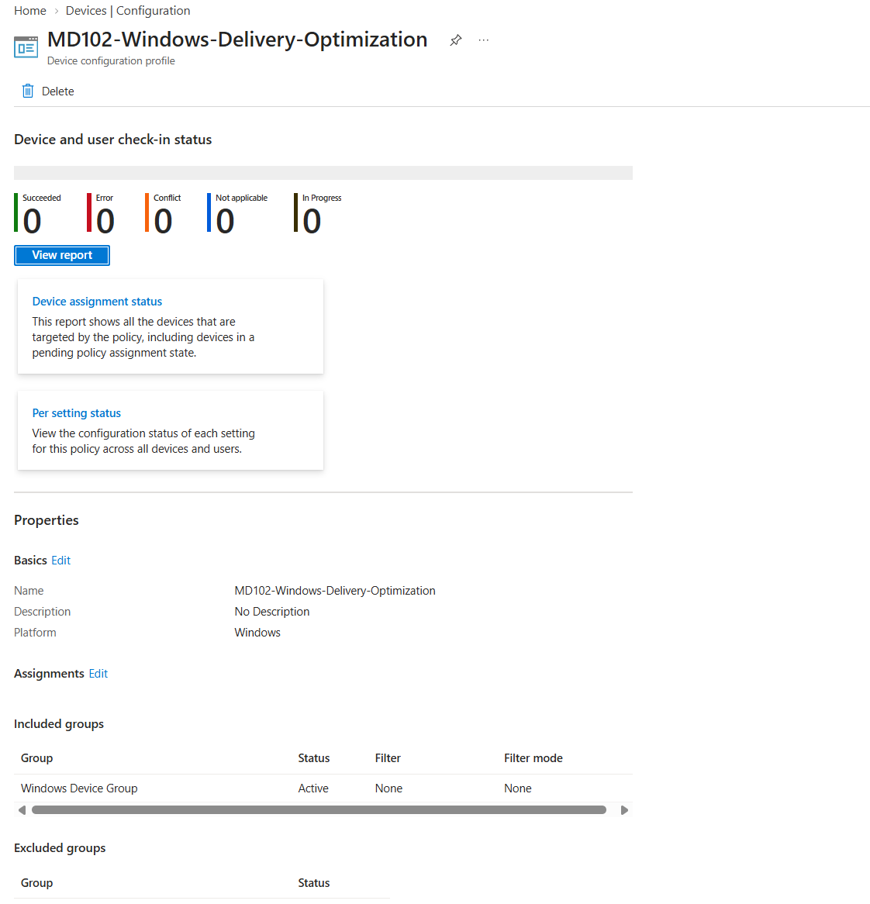

# Lab 10 - Update Management

## Objective

Configure Windows update management in Microsoft Intune, review deployment monitoring, and configure Delivery Optimization for managed Windows devices.

## Environment

| Component | Configuration |
|---|---|
| Endpoint | MD102-CL02 |
| Operating System | Windows 11 |
| Management Platform | Microsoft Intune |
| Target Group | Windows Device Group |

---

## 1. Windows Update Ring

A Windows Update Ring named `MD102-Windows-Update-Ring` was created and assigned to `Windows Device Group`.

The policy was configured with:

- Microsoft product updates enabled
- Windows driver updates enabled
- Quality update deferral: 7 days
- Feature update deferral: 30 days
- Automatic Windows 10 to Windows 11 upgrade disabled
- Feature update uninstall period: 10 days
- Active hours: 08:00 - 17:00
- Users prevented from pausing updates
- Windows Update notifications enabled
- Feature update deadline: 7 days
- Quality update deadline: 2 days
- Grace period: 2 days
- Automatic reboot before deadline disabled

---

## 2. Update Monitoring

Windows Update monitoring was reviewed from the Intune admin center.

The monitoring views provide information such as:

- Update ring deployment status
- Devices with errors
- Policy conflicts
- Feature update alerts
- Quality update alerts
- Driver update alerts

---

## 3. Update Troubleshooting

Windows update troubleshooting workflows were reviewed.

Common policy states include:

- Succeeded
- Pending
- Error
- Conflict

For affected devices, Intune can be used to review information such as device status, last check-in, policy state, and update-related errors.

Policy conflicts can also be investigated when multiple update configurations target the same endpoint.

---

## 4. Delivery Optimization

A Delivery Optimization policy named `MD102-Windows-Delivery-Optimization` was created and assigned to `Windows Device Group`.

Delivery Optimization was configured to allow peer-to-peer content sharing between Windows devices on the same local network.

This allows managed endpoints to retrieve supported Microsoft content from local peers instead of downloading all content independently from the internet.

---

## Notes

Android update management and Apple platform update management were reviewed during the training.

No Android, iOS, iPadOS, or macOS devices were available in the lab, so update policies for those platforms were not deployed.

---

## Result

The following tasks were completed:

- Created and assigned a Windows Update Ring
- Configured quality and feature update deferrals
- Configured active hours and update deadlines
- Reviewed Windows Update deployment monitoring
- Reviewed update troubleshooting workflows
- Created and assigned a Delivery Optimization policy
- Configured local peer-to-peer update delivery

Android and Apple update management were reviewed without endpoint deployment.
