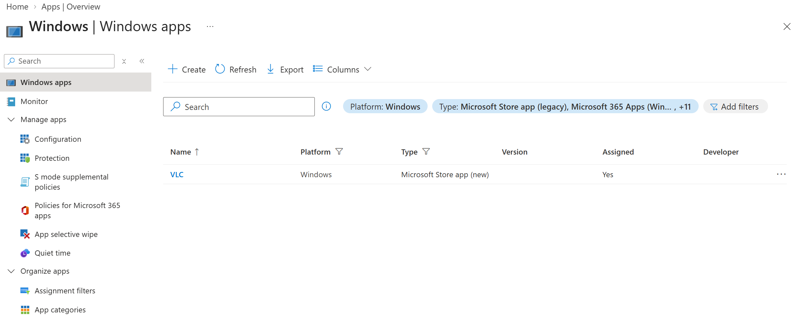
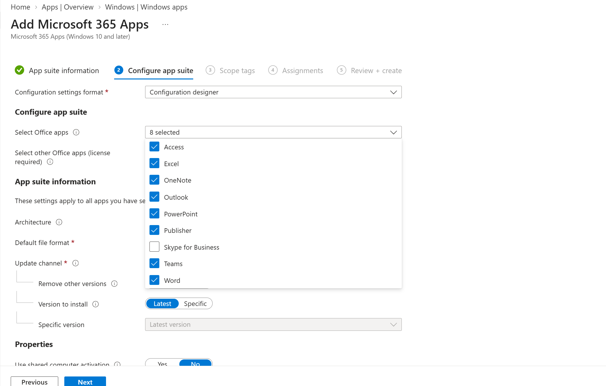
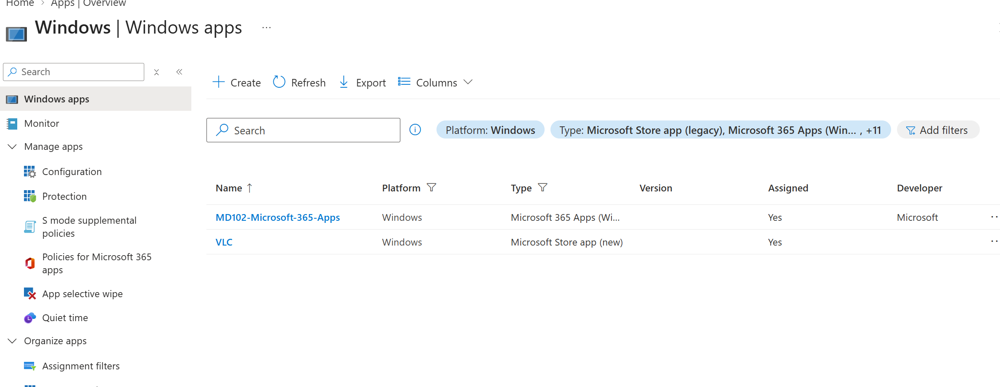
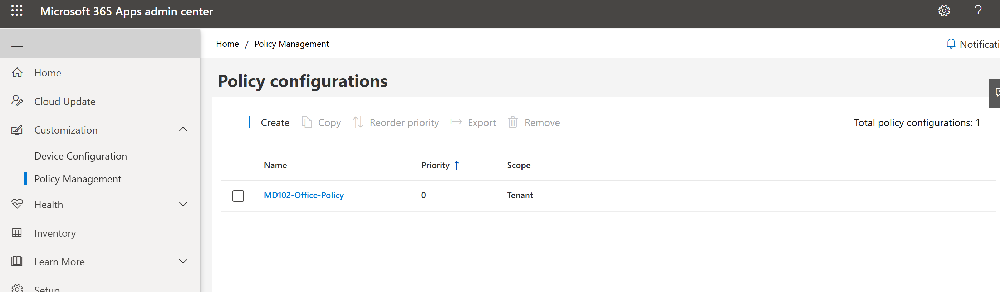

# Lab 11 - Application Management

## Objective

Configure application deployment in Microsoft Intune using Microsoft Store apps, Microsoft 365 Apps, and Microsoft 365 Apps Cloud Policy.

## Environment

| Component | Configuration |
|---|---|
| Endpoint | MD102-CL02 |
| Operating System | Windows 11 |
| Management Platform | Microsoft Intune |
| Target Group | Windows Device Group |

---

## 1. Microsoft Store App Deployment

VLC was added from Microsoft Store (new) in Microsoft Intune.

The application was assigned to `Windows Device Group` as a required application.

---

## 2. Microsoft 365 Apps Configuration

A Microsoft 365 Apps deployment was created for managed Windows devices.

The configuration included:

- Microsoft Word
- Microsoft Excel
- Microsoft PowerPoint
- Microsoft Outlook
- Microsoft OneNote
- 64-bit architecture

---

## 3. Microsoft 365 Apps Assignment

The Microsoft 365 Apps deployment was assigned to `Windows Device Group` as a required application.

The deployment configuration and assignment were completed in Intune.

Application installation on `MD102-CL02` was not validated during this lab.

---

## 4. Office Deployment Tools

The Office Deployment Tool and Office Customization Tool were reviewed.

These tools can be used to:

- Select Microsoft 365 applications
- Configure installation architecture
- Define update channels
- Generate deployment configuration files
- Customize enterprise Office deployments

A separate Office Deployment Tool package was not deployed because Microsoft 365 Apps was configured directly through Intune.

---

## 5. Microsoft 365 Apps Cloud Policy

Microsoft 365 Apps Cloud Policy was configured through the Microsoft 365 Apps admin center.

The policy included settings such as:

- Blocking macros in Office files from the Internet
- Managing Office first-run behavior
- Managing Microsoft 365 Apps update behavior

---

## Result

The following application management tasks were completed:

- Added VLC through Microsoft Store (new)
- Assigned VLC as a required application
- Created a Microsoft 365 Apps configuration
- Assigned Microsoft 365 Apps to `Windows Device Group`
- Reviewed Office Deployment Tool and Office Customization Tool
- Configured Microsoft 365 Apps Cloud Policy

Microsoft 365 Apps installation on `MD102-CL02` was not validated during this lab.
