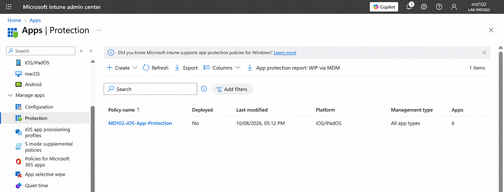
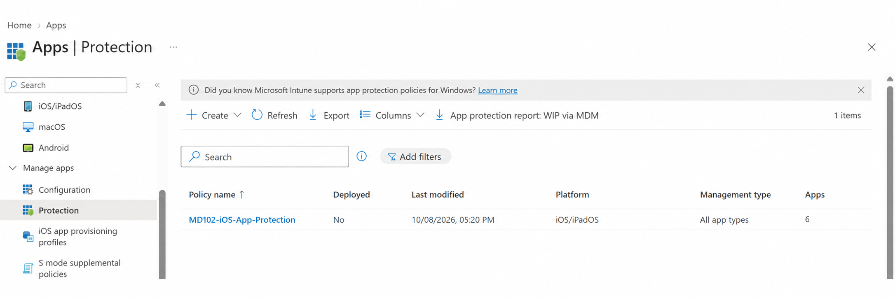
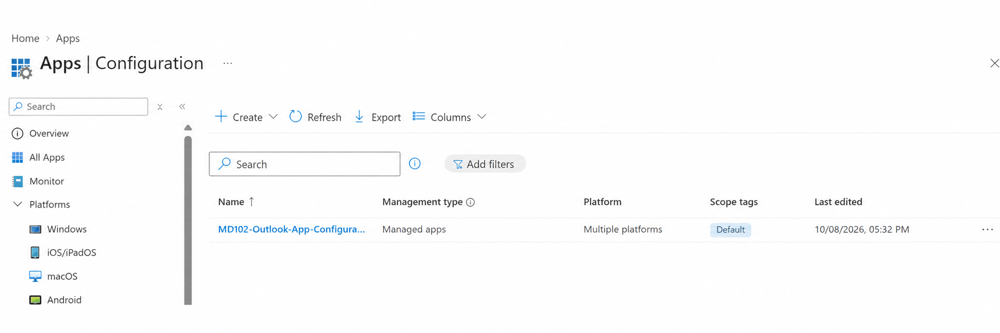

# Lab 12 - App Protection and App Configuration

## Objective

Configure Microsoft Intune App Protection and App Configuration policies for iOS/iPadOS application management scenarios.

## Environment

| Component | Configuration |
|---|---|
| Management Platform | Microsoft Intune |
| Identity Platform | Microsoft Entra ID |
| Target Users | MD102-Intune-Users |
| Platform | iOS/iPadOS |
| Managed Application | Microsoft Outlook |

---

## 1. iOS/iPadOS App Protection Policy

An App Protection Policy named `MD102-iOS-App-Protection` was created.

The policy targeted supported Microsoft applications including:

- Microsoft Outlook
- Microsoft Teams
- Microsoft OneDrive
- Microsoft Word
- Microsoft Excel

The policy was assigned to `MD102-Intune-Users`.

Data protection settings included:

- Restrict organizational data transfer to policy-managed apps
- Block saving organizational data to unmanaged locations
- Restrict copy and paste between managed and unmanaged apps
- Require encryption for organizational data
- Block synchronization with unmanaged native apps
- Block printing of organizational data

Access requirements included:

- Require a PIN
- Enforce a minimum PIN length
- Allow biometric authentication
- Require a work or school account

---

## 2. Conditional Access for App Protection

A Conditional Access policy named `MD102-Require-App-Protection` was created.

The policy targeted `MD102-Intune-Users` and mobile device platforms.

The grant control was configured to require an App Protection Policy.

The policy was left in Report-only mode during testing.

---

## 3. Outlook App Configuration Policy

An App Configuration Policy named `MD102-Outlook-App-Configuration` was created for Microsoft Outlook on iOS/iPadOS.

The policy was assigned to `MD102-Intune-Users`.

Selected Outlook settings were configured centrally through Intune.

---

## 4. Managed Apps vs Managed Devices

App Protection Policies and App Configuration Policies were reviewed as separate controls.

App Protection Policies manage how organizational data can be used inside supported applications.

App Configuration Policies manage application-specific settings and behavior.

These controls can be used without requiring full device management in every mobile application scenario.

---

## Result

The following tasks were completed:

- Created an iOS/iPadOS App Protection Policy
- Configured organizational data protection controls
- Configured application access requirements
- Assigned the policy to `MD102-Intune-Users`
- Created a Conditional Access policy requiring App Protection
- Configured Conditional Access in Report-only mode
- Created an Outlook App Configuration Policy
- Assigned the Outlook configuration to managed users

A physical iOS/iPadOS device was not available, so application behavior was not validated on an endpoint.
