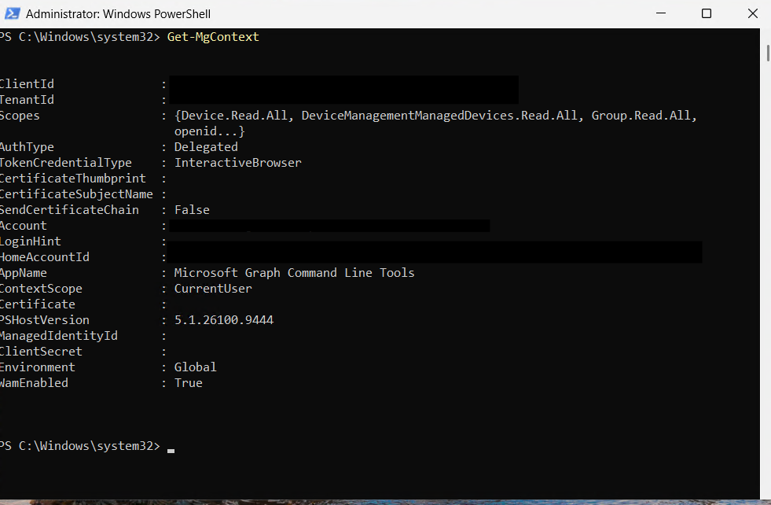
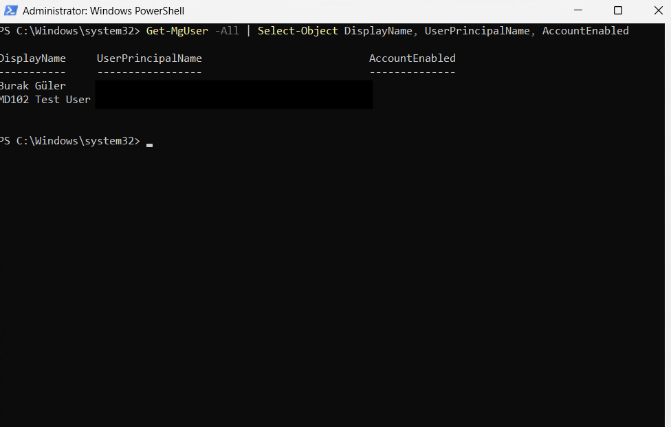
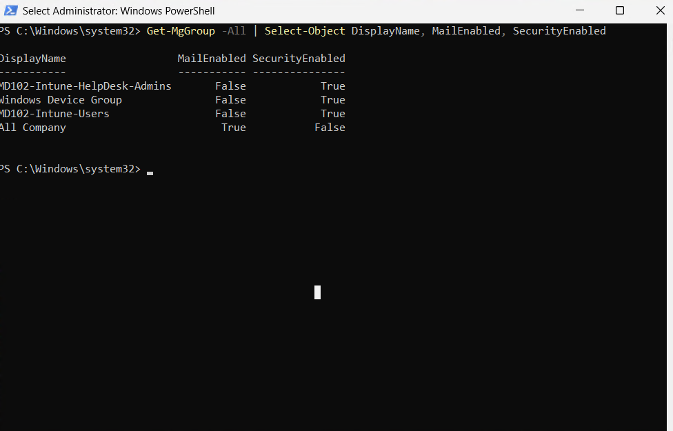
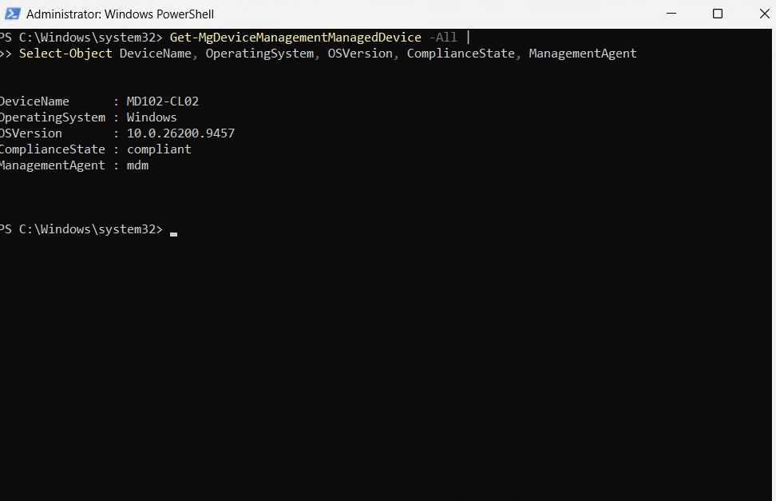

# Lab 13 - PowerShell and Microsoft Graph Automation

## Objective

Use PowerShell and Microsoft Graph to query Microsoft Entra ID and Microsoft Intune resources from a managed Windows 11 endpoint.

## Environment

| Component | Configuration |
|---|---|
| Endpoint | MD102-CL02 |
| Operating System | Windows 11 |
| Automation Tool | Windows PowerShell |
| API Platform | Microsoft Graph |
| Identity Platform | Microsoft Entra ID |
| Device Management Platform | Microsoft Intune |

---

## 1. Microsoft Graph PowerShell SDK

The Microsoft Graph PowerShell SDK was installed on `MD102-CL02`.

PowerShell execution policy was configured for the current user so the required modules could run.

Microsoft Graph authentication was then started with:

```powershell
Connect-MgGraph -Scopes "User.Read.All","Group.Read.All","Device.Read.All","DeviceManagementManagedDevices.Read.All"
```

The active Graph session was verified with:

```powershell
Get-MgContext
```



---

## 2. Query Microsoft Entra Users

Microsoft Entra ID users were queried through Microsoft Graph PowerShell.

```powershell
Get-MgUser -All |
Select-Object DisplayName, UserPrincipalName, AccountEnabled
```



---

## 3. Query Microsoft Entra Groups

Microsoft Entra groups were queried with:

```powershell
Get-MgGroup -All |
Select-Object DisplayName, MailEnabled, SecurityEnabled
```



---

## 4. Query Intune Managed Devices

Managed Windows devices were queried directly from Microsoft Intune through Microsoft Graph.

```powershell
Get-MgDeviceManagementManagedDevice -All |
Select-Object DeviceName, OperatingSystem, OSVersion, ComplianceState, ManagementAgent
```

This returned device inventory and management information without using the Intune admin center.



---

## 5. Automation Scenarios

The Graph queries used in this lab can be extended for tasks such as:

- User and group reporting
- Managed device inventory
- Compliance reporting
- Bulk administration
- Scheduled reporting
- Policy automation

No production automation was created as part of this lab.

---

## Notes

Microsoft Security Copilot concepts and Intune integration scenarios were reviewed during the training.

A Security Copilot workspace and Security Compute Units were not provisioned in this lab.

---

## Result

The following tasks were completed:

- Installed the Microsoft Graph PowerShell SDK
- Connected PowerShell to Microsoft Graph
- Verified the active Graph session
- Queried Microsoft Entra ID users
- Queried Microsoft Entra ID groups
- Queried Microsoft Intune managed devices

Microsoft Security Copilot was reviewed without provisioning paid resources.
