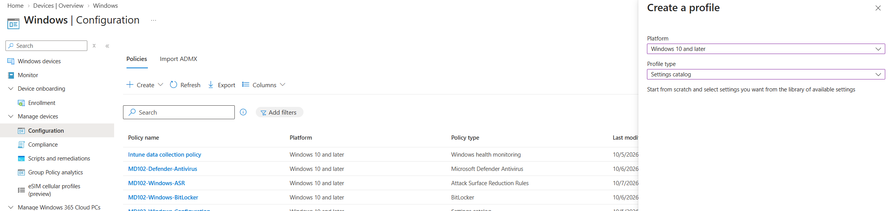
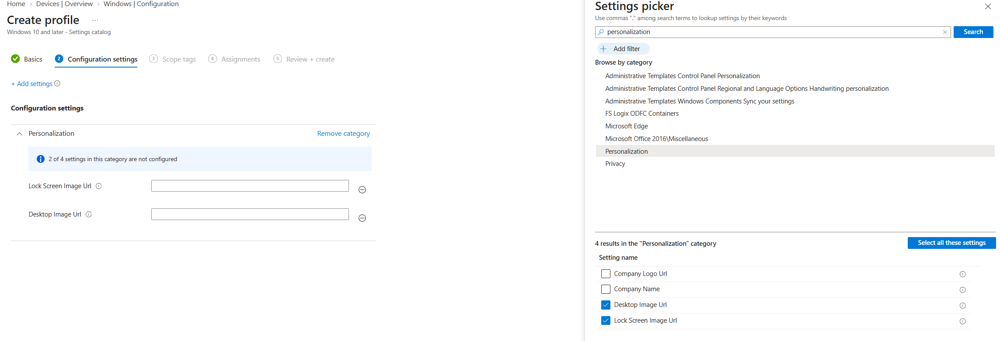
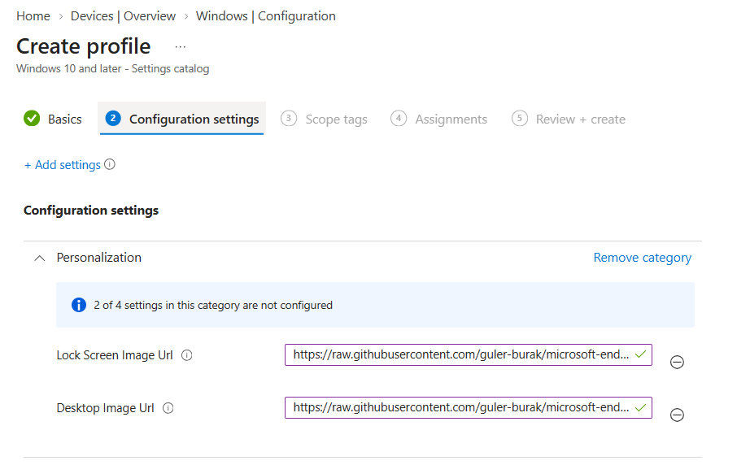
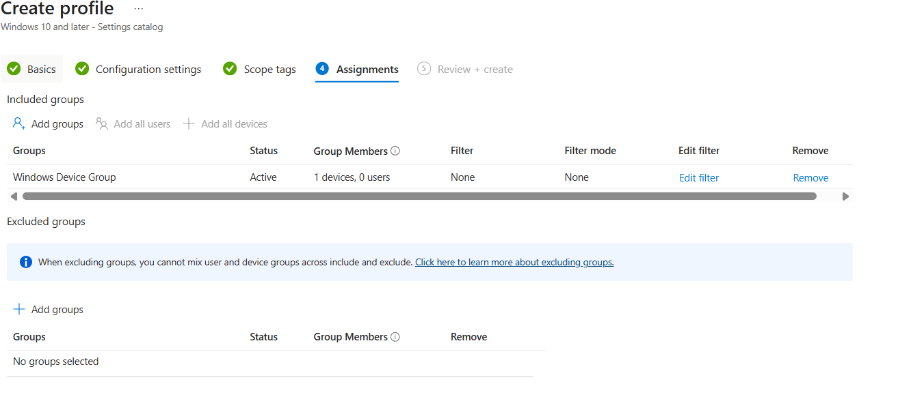
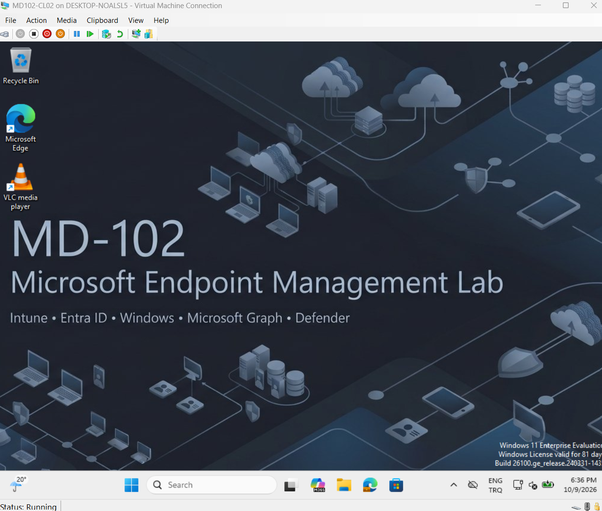
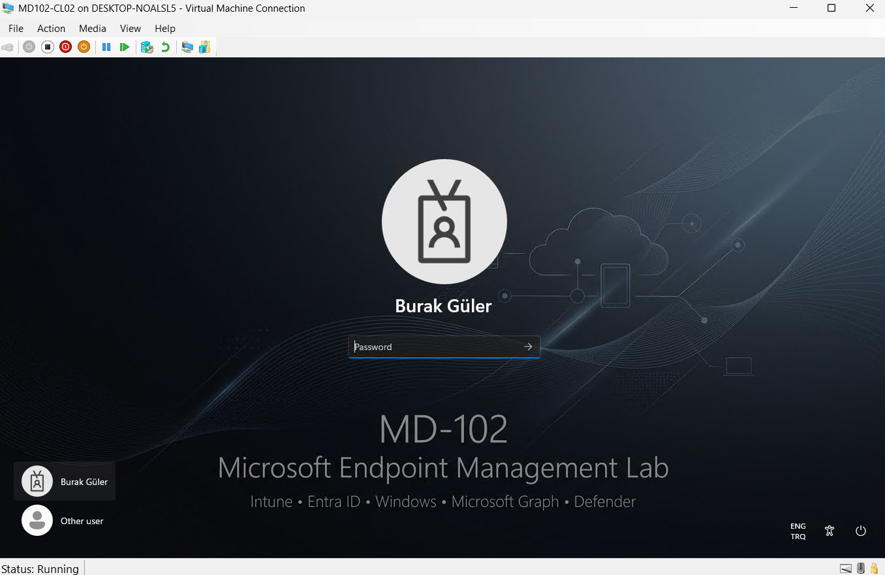

# Lab 14 - Windows Personalization and Corporate Branding

## Objective

Configure centralized Windows desktop and lock screen branding through Microsoft Intune and validate the configuration on a managed Windows 11 endpoint.

## Environment

| Component | Configuration |
|---|---|
| Endpoint | MD102-CL02 |
| Operating System | Windows 11 |
| Management Platform | Microsoft Intune |
| Profile Type | Settings Catalog |
| Policy | MD102-Windows-Personalization |
| Target Group | Windows Device Group |
| Image Hosting | GitHub |
| Delivery | HTTPS |

---

## 1. Create the Personalization Policy

A Windows Settings Catalog profile was created in Microsoft Intune.

Configuration:

- Platform: Windows 10 and later
- Profile type: Settings catalog
- Policy name: `MD102-Windows-Personalization`



---

## 2. Policy Configuration

The profile was created specifically for centrally managed Windows personalization settings.



---

## 3. Desktop and Lock Screen Images

The following personalization settings were configured:

- `Desktop Image Url`
- `Lock Screen Image Url`

The source images were stored in the repository under:

```text
assets/wallpapers/
```

The managed endpoint retrieved the images through direct HTTPS URLs.



---

## 4. Policy Assignment

The personalization policy was assigned to:

`Windows Device Group`

This allowed the configuration to be delivered automatically to the targeted Windows devices.



---

## 5. Desktop Wallpaper Validation

After Intune synchronization, the configured desktop wallpaper was applied successfully to `MD102-CL02`.



---

## 6. Lock Screen Validation

The Windows lock screen configuration was also applied successfully to `MD102-CL02`.



---

## Configuration Flow

```text
GitHub Repository
        |
        | HTTPS
        v
Microsoft Intune
        |
        | Settings Catalog
        v
Windows Device Group
        |
        v
MD102-CL02
        |
        +--> Desktop Wallpaper
        |
        +--> Lock Screen Image
```

---

## Result

The following configuration was completed and validated:

- Created a Windows personalization profile
- Configured desktop wallpaper through Intune
- Configured the Windows lock screen image
- Stored branding assets in GitHub
- Assigned the policy to `Windows Device Group`
- Validated the desktop wallpaper on `MD102-CL02`
- Validated the lock screen image on `MD102-CL02`
