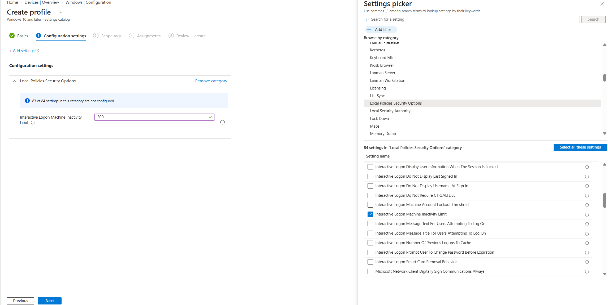
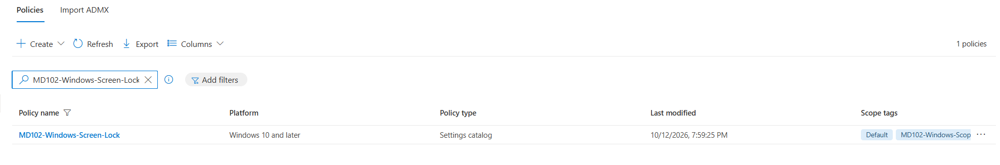
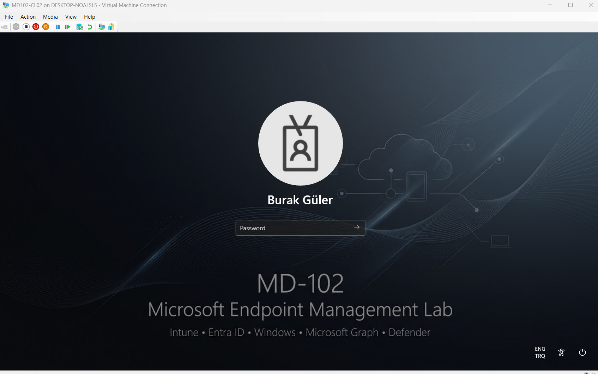

# Lab 15 - Windows Screen Lock

## Objective

Configure an inactivity-based Windows screen lock policy in Microsoft Intune and validate the resulting configuration on a managed Windows 11 endpoint.

## Environment

| Component | Configuration |
|---|---|
| Endpoint | MD102-CL02 |
| Operating System | Windows 11 |
| Management Platform | Microsoft Intune |
| Profile Type | Settings Catalog |
| Policy | MD102-Windows-Screen-Lock |
| Target Group | Windows Device Group |

---

## 1. Screen Lock Policy

A Windows Settings Catalog policy named `MD102-Windows-Screen-Lock` was created.

The following setting was configured:

`Interactive Logon: Machine inactivity limit`

This setting controls the inactivity period before Windows locks the interactive user session.

---

## 2. Policy Creation

The configuration profile was created in Microsoft Intune and targeted to managed Windows devices.

---

## 3. Endpoint Validation

The resulting screen lock configuration was checked on `MD102-CL02`.

The endpoint reflected the centrally managed inactivity configuration after the Intune policy was applied.

---

## Result

The following tasks were completed:

- Created a Windows Settings Catalog screen lock policy
- Configured `Interactive Logon: Machine inactivity limit`
- Assigned the policy to managed Windows devices
- Checked the resulting configuration on `MD102-CL02`
