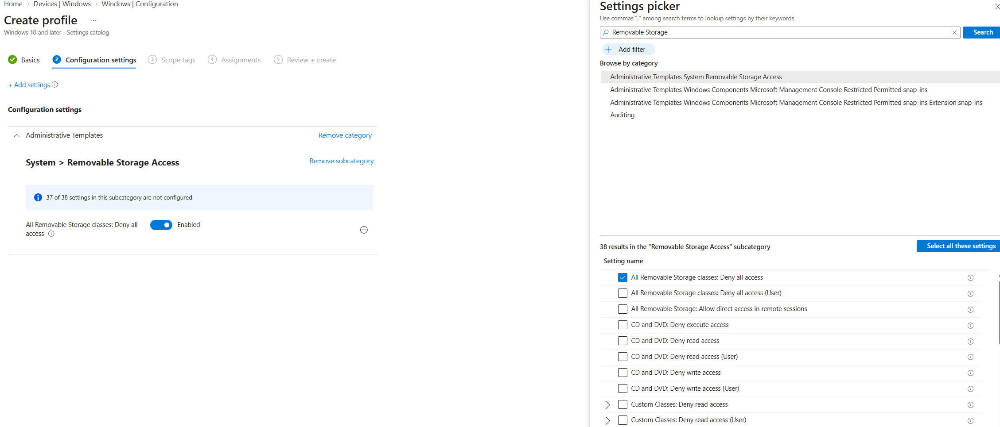
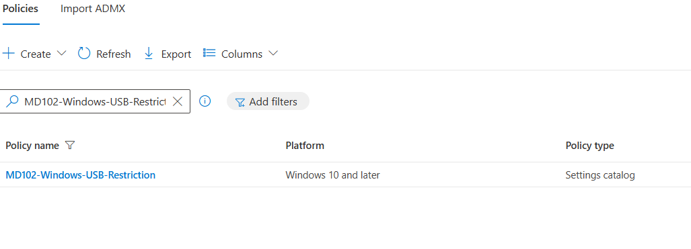
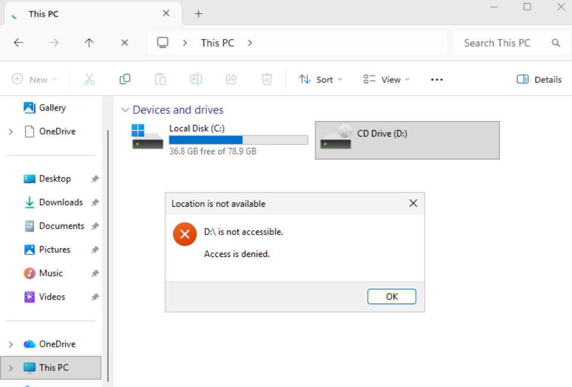

# Lab 16 - USB Storage Restriction

## Objective

Block access to removable USB storage on a managed Windows 11 endpoint using Microsoft Intune.

## Environment

| Component | Configuration |
|---|---|
| Endpoint | MD102-CL02 |
| Operating System | Windows 11 |
| Management Platform | Microsoft Intune |
| Profile Type | Settings Catalog |
| Policy | MD102-Windows-USB-Restriction |
| Target Group | Windows Device Group |

---

## 1. USB Restriction Policy

A Windows Settings Catalog policy named `MD102-Windows-USB-Restriction` was created.

The following setting was enabled:

`All Removable Storage classes: Deny all access`

This setting blocks access to removable storage classes on targeted Windows devices.

---

## 2. Policy Deployment

The policy was assigned to `Windows Device Group`.

---

## 3. Endpoint Validation

A removable drive was redirected to `MD102-CL02` through Hyper-V Enhanced Session Mode.

After Intune synchronization, access to the removable drive was blocked on the managed endpoint.

---

## Result

The following tasks were completed:

- Created a Windows removable storage restriction policy
- Enabled `All Removable Storage classes: Deny all access`
- Assigned the policy to managed Windows devices
- Synchronized the Intune-managed endpoint
- Validated blocked removable storage access on `MD102-CL02`
